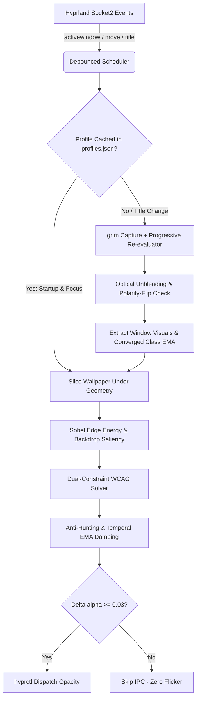

<div align="center">


# hyprsmart
### *Adaptive intelligence for Hyprland*

[](https://python.org)
[](https://hyprland.org)
[](https://www.w3.org/WAI/standards-guidelines/wcag/)
[](LICENSE)

*Real-time, deterministic, and ergonomically calibrated window transparency for the Hyprland Wayland compositor.*

</div>

---

## What is HyprSmart?

Hyprland's window transparency is gorgeous—until a light wallpaper renders your code editor illegible, or a dark video player gets washed out. Constantly juggling manual toggles (`toggleopaque`) is disruptive to workflow and breaks immersion.

**HyprSmart** acts as an adaptive perceptual daemon. It continuously observes window activity, analyses foreground text and background dominance, measures the exact wallpaper clutter behind each window, and dynamically computes the optimal opacity level. 

Every adjustment guarantees text clarity according to **WCAG 2.x relative luminance contrast standards**, giving you effortless, beautiful transparency that never sacrifices readability.

---

## Key Features

- **Mathematical Determinism (Zero Latency)**: No heavy AI models, OCR, or local LLM inferencing in the loop. Opacity decisions are computed in $< 1.5\text{ ms}$ using vectorized sRGB relative luminance and Sobel edge energy.
- **Optical Unblending (Deconvolution)**: Eliminates screen flashes and transparency feedback loops. Transparent windows are captured as-is and their pure original colors are mathematically reconstructed by inverting alpha compositing ($L_{pure} = \frac{L_{captured} - (1 - \alpha) L_{backdrop}}{\alpha}$).
- **Multi-Signal Video Detection**: Distinguishes streaming video and multimedia windows from static text documents using PipeWire audio emission markers, idle-inhibition flags, full-screen states, and low text density. Automatically clamps opacity (e.g. `0.92` - `1.0`) to preserve contrast.
- **Universal Startup Preloading**: When the daemon launches, all open windows across all workspaces and monitors immediately adopt their ideal transparency using cached profiles, without requiring manual clicks or focus shifts.
- **Persistent & Emergent Dynamic Profiles (`~/.config/hyprsmart/profiles.json`)**: Automatically learns visual fingerprints (`text_l`, `bg_l`, `text_density`, `bg_ratio`) and temporal dynamics (`volatility`, `settle_time`, `sample_count`) per window class using Exponential Moving Averages (EMA).
- **Cancelable Progressive Re-evaluation**: Tracks slow-loading windows (browsers, SPAs, Electron apps) across up to `11` one-second ticks (stopping early after `8` consecutive stable seconds), adapting the probing budget per class as its dynamic profile emerges.
- **Anti-Wobble & Anti-Hunting Stabilization**: Guarantees silky-smooth settling on dynamic pages (carousels, cursor blinking, CSS animations) through low-pass EMA temporal damping on micro-jumps ($\le 0.10$), $50\%$ attenuation of spatial texture noise, and sensitivity threshold annealing after $t > 3\text{s}$.
- **Polarity-Flip Adaptation**: Detects major contrast shifts ($|\Delta L| > 0.25$, e.g. dark splash screen to white web page) and immediately bypasses class regularization for instant $100\%$ adaptation.
- **Privacy Shield & IPC Hardening**: Built-in credential shield prevents screen capture of password managers (`keepassxc`, `bitwarden`, `1password`, `polkit`, incognito sessions) by automatically forcing them fully opaque without saving pixels. Control sockets enforce strict `0o600` permissions and kernel-level `SO_PEERCRED` caller UID authorization.
- **Micro-Reactive Adjustments**: Focus switches, window dragging across light/dark wallpaper areas, and resizing seamlessly trigger microscopic opacity updates tailored in real-time to the user's eye.

---

## Architectural Flow



---

## Installation & Requirements

### System Requirements
- **OS**: Linux with Wayland
- **Compositor**: [Hyprland](https://hyprland.org) ($\ge 0.40.0$)
- **Tools**: `grim` (for screen captures), `hyprctl`, and PipeWire (`pactl` or `pw-cli`)
- **Python**: $\ge 3.14$ (or running via `uv`)

### Installation via uv
```bash
git clone https://github.com/ctlinker/hyprsmart.git
cd hyprsmart
uv sync
```

---

## Usage

### Controlling the Daemon
```bash
# Start the resident daemon in the background
hyprsmart start

# Inspect live decision logs in real-time
hyprsmart what-is-it-doing --watch

# Inspect the last 20 actions
hyprsmart what-is-it-doing -n 20

# Stop the daemon (automatically restores all windows to 1.0)
hyprsmart stop
```

### Inspecting & Tweaking Settings
HyprSmart features an interactive CLI settings manager:

```bash
# View all active settings, bounds, and descriptions
hyprsmart settings

# Adjust the target WCAG contrast ratio (default: 6.0 — sweet spot for legibility & aesthetics)
hyprsmart settings target_contrast 6.0

# Adjust minimum transparency floor (default: 0.5)
hyprsmart settings floor_opacity 0.45

# Adjust fixed opacity for detected video streams (default: 0.92)
hyprsmart settings video_opacity 0.95

# Configure progressive re-evaluation ticks and early-stop stability
hyprsmart settings reeval_max_ticks 11
hyprsmart settings reeval_stable_ticks 8
```

### Developer Diagnostic Snapshot Mode
Capture immediate decision artifacts for debugging without modifying ongoing workflows:

```bash
# Capture the active window, compute the WCAG decision, and save before.png, after.png,
# and metadata.json (complete solver logs, backdrop slicing, and contrast breakdown)
hyprsmart --yes-am-a-dev-on-this-project-and-i-fully-understand-what-this-flag-does
```
Artifacts are automatically deposited in `~/.local/state/hyprsmart/dev_captures/` with detailed timestamps.

---

## Configuration (`config.yaml`)

Configuration files are located in `~/.config/hyprsmart/config.yaml`:

```yaml
monitors:
  '0': /home/user/Pictures/Wallpapers/mountain.png
  eDP-1: /home/user/Pictures/Wallpapers/mountain.png
default_wallpaper: /home/user/Pictures/Wallpapers/default.png
target_contrast: 6.0
floor_opacity: 0.5
video_opacity: 0.92
debounce_interval: 0.1
reeval_max_ticks: 11
reeval_stable_ticks: 8
reeval_interval: 1.0
```

---

## Documentation & Wiki

Explore the complete technical specifications and session journals in our **[Wiki](wiki/README.md)**:

- **[Under the Hood](wiki/under-the-hood/README.md)**:
  - [01. sRGB Relative Luminance & WCAG Contrast](wiki/under-the-hood/01_wcag_relative_luminance.md)
  - [02. Spatial Gradients & Sobel Edge Energy](wiki/under-the-hood/02_spatial_gradient_and_edge_detection.md)
  - [03. Window Content Analysis & Bit-Shift Quantization](wiki/under-the-hood/03_window_content_analysis.md)
  - [04. Wallpaper Sampling & Coordinate Geometry](wiki/under-the-hood/04_wallpaper_sampling_and_caching.md)
  - [05. Wayland IPC & Multi-Threaded Architecture](wiki/under-the-hood/05_wayland_ipc_and_threading.md)
  - [06. Multi-Signal Video Detection](wiki/under-the-hood/06_multi_signal_video_detection.md)
  - [07. Dynamic Caching & Trailing Debounce](wiki/under-the-hood/07_dynamic_caching_and_deferred_execution.md)
  - [08. Optical Unblending & Persistent Class Profiles](wiki/under-the-hood/08_optical_unblending_and_class_profiles.md)
  - [09. Progressive Re-evaluation, Dynamic Profiles & Anti-Wobble](wiki/under-the-hood/09_progressive_reevaluation_and_dynamic_profiles.md)
  - [10. Security Model, IPC Hardening & Privacy Shield](wiki/under-the-hood/10_security_model_and_privacy_shield.md)
  - [Archives: Historical & Deprecated Architectures](wiki/under-the-hood/archives/README.md)
- **[Session Reports](wiki/reports/README.md)**: Chronological index of all 20+ development reports and design decisions.

---

## License

This project is licensed under the MIT License — see the [LICENSE](LICENSE) file for details.
