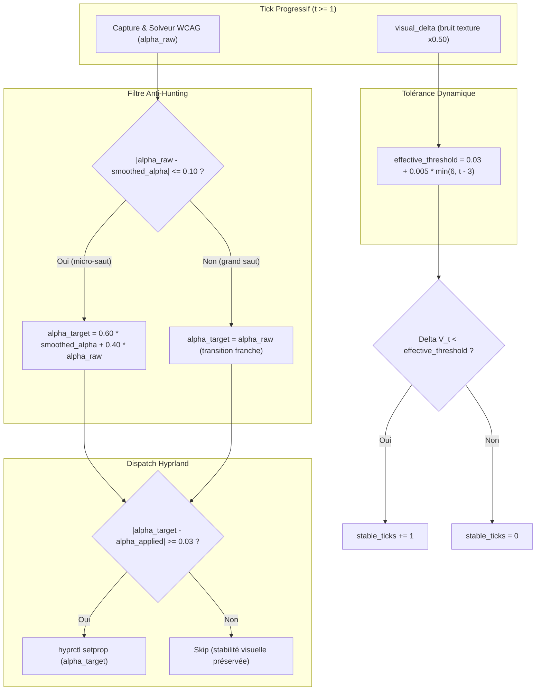

# Rapport de Session : Stabilisation Anti-Wobble de la Réévaluation Progressive

- **Date** : 2026-10-16
- **Version** : `0.8.1`
- **Branche** : `feat/progressive-change`
- **Auteur** : Agent IA Antigravity `[ai]`

---

## 1. Contexte & Demande Utilisateur

Suite au déploiement du moteur de réévaluation progressive (`0.8.0`), l'utilisateur a testé le comportement en conditions réelles et formulé le retour suivant :
> *"hum audit the feature, it works perfectly on my end thought it wooble a bit at the end of fairly dinamyc window."*

Le moteur fonctionnait comme prévu pour accompagner le chargement asynchrone des pages web et applications Electron, mais un léger sautillement ou oscillation visuelle d'opacité ("wobble") apparaissait en fin de session sur les fenêtres au contenu modérément dynamique (curseur clignotant, bannières légères, carrousels en arrière-plan, animations CSS mineures).

---

## 2. Diagnostic & Analyse des Causes Racines

L'audit approfondi de la chaîne d'évaluation a mis en évidence trois causes conjuguées :

### 2.1 Le phénomène de chasse (hunting) sur frontière de discrétisation
- Le solveur WCAG [`decide_opacity`](../../src/hyprsmart/opacity/compute.py) recherche l'opacité optimale sur une grille discrète à pas de `0.05` ($0.50, 0.55, 0.60, 0.65, 0.70, \dots$).
- Le seuil de dispatch IPC [`DIFF_OPACITY_THRESHOLD`](../../src/hyprsmart/daemon/handle.py) était fixé à `0.03`.
- Par conséquent, dès qu'une fluctuation visuelle infinitésimale faisait basculer le score WCAG d'un cran (ex: de $0.65$ à $0.70$), la différence $|\Delta\alpha| = 0.05$ dépassait immédiatement $0.03$, envoyant un appel IPC `hyprctl setprop`. Au tick suivant, une infime variation inverse ramenait à $0.65$, créant un ping-pong visuel persistant.

### 2.2 Sensibilité excessive au bruit de texture locale dans `visual_delta`
- La métrique $\Delta V_t$ agrégeait avec un poids uniforme ($1.0$) la luminance du texte, la luminance du fond, le ratio de fond et la densité textuelle :
  $$\Delta V_t = \max\Big( |\Delta L_{\text{bg}}|, \; |\Delta L_{\text{text}}|, \; |\Delta R_{\text{bg}}|, \; |\Delta D_{\text{text}}| \Big)$$
- Sur une page web chargée, le clignotement d'un curseur texte (`<textarea>`) ou une animation SVG périphérique fait fluctuer $D_{\text{text}}$ ou $R_{\text{bg}}$ d'environ $0.035 \sim 0.045$.
- Bien que le fond et le texte principal soient parfaitement immobiles, ce bruit de texture dépassait le seuil de $0.03$, réinitialisant en boucle `stable_ticks = 0` et maintenant la fenêtre en réévaluation forcée jusqu'au 11ᵉ tick.

### 2.3 Rétroaction optique avec les transitions du compositeur
- Lorsque Hyprland anime le changement d'opacité via ses courbes Bézier sRGB (`fade / opacity`), une capture effectuée à $t = 1\text{s}$ peut échantillonner une fenêtre en cours d'interpolation.
- Le démélangeur optique (`unblend_luminance`), mesurant cette luminance transitoire, réévaluait une cible légèrement différente, entretenant une instabilité cyclique.

---

## 3. Solutions Techniques & Architecture Anti-Wobble

Trois garde-fous complémentaires ont été intégrés dans [`src/hyprsmart/daemon/handle.py`](../../src/hyprsmart/daemon/handle.py) et [`src/hyprsmart/opacity/win_col.py`](../../src/hyprsmart/opacity/win_col.py) :



### 3.1 Amortisseur temporel passe-bas (`smoothed_alpha`)
- Ajout de `smoothed_alpha` au sein de [`ProgressiveSession`](../../src/hyprsmart/daemon/handle.py), initialisé à l'opacité appliquée à $t_0$.
- Pour toute fluctuation mineure $|\alpha_{\text{raw}} - \alpha_{\text{smoothed}}| \le 0.10$ (typiquement un aller-retour d'un ou deux crans de grille), l'opacité cible est lissée par un filtre passe-bas :
  $$\alpha_{\text{target}} = 0.60 \cdot \alpha_{\text{smoothed}} + 0.40 \cdot \alpha_{\text{raw}}$$
- Un dispatch IPC n'est déclenché que si $|\alpha_{\text{target}} - \alpha_{\text{applied}}| \ge 0.03$. Les micro-oscillations entre $0.65$ et $0.70$ s'amortissent instantanément vers une valeur stable ($0.67 \sim 0.68$) sans réémission continue d'ordres IPC.
- En cas de bascule franche ($|\Delta\alpha| > 0.10$), l'amortisseur est contourné immédiatement (`target_alpha = raw_alpha`) pour ne pas retarder l'adaptation sur les changements structurels majeurs.

### 3.2 Pondération sélective du bruit spatial dans `visual_delta`
- Révision de [`visual_delta`](../../src/hyprsmart/opacity/win_col.py) :
  $$\Delta V_t = \max\Big( |\Delta L_{\text{bg}}|, \; |\Delta L_{\text{text}}|, \; 0.50 \times |\Delta R_{\text{bg}}|, \; 0.50 \times |\Delta D_{\text{text}}| \Big)$$
- Les variations de luminance globale ($L_{\text{bg}}$ et $L_{\text{text}}$) conservent leur plein impact ($1.0$). En revanche, les micro-variations de texture spatiale et de contours ($R_{\text{bg}}$, $D_{\text{text}}$), représentatives des curseurs et carrousels légers, sont pondérées à $50\%$. Le bruit résiduel ($0.035 \times 0.50 = 0.0175$) tombe ainsi nettement en-dessous du seuil de stabilité.

### 3.3 Recuit thermique du seuil temporel (`effective_threshold`)
- Au début d'une session ($t \le 3$), le seuil reste strict à `0.03` pour détecter tous les changements de chargement.
- Au-delà de 3 secondes ($t > 3$), un recuit dynamique élargit progressivement le seuil :
  $$\text{threshold}_{\text{eff}}(t) = 0.03 + 0.005 \times \min\big(6, \; t - 3\big)$$
- Ce seuil s'élève en douceur jusqu'à `0.06` à $t = 9\text{s}$. Cela permet aux fenêtres dynamiques dont le chargement principal est achevé de converger et d'accumuler leurs `stable_ticks` sans être retenues indûment jusqu'au tick 11.

---

## 4. Validation & Tests Unitaires

Deux nouveaux tests unitaires ciblés ont été ajoutés à [`tests/test_progressive_reeval.py`](../../tests/test_progressive_reeval.py) :
1. `test_visual_delta_scales_texture_noise` : Valide qu'un saut de texture/densité de `0.04` produit un $\Delta V_t = 0.02$, restant considéré comme stable ($< 0.03$), tandis qu'un saut de luminance équivalent produit un $\Delta V_t = 0.04$ réinitialisant le compteur.
2. `test_anti_hunting_dampens_micro_fluctuations` : Valide qu'une alternance d'opacités brutes $0.70 \leftrightarrow 0.65$ est amortie par le filtre EMA et évite le déclenchement intempestif de dispatches IPC répétés.

Exécution de la suite complète :
```bash
.venv/bin/python -m unittest discover tests -v
# 38 tests unitaires exécutés, 38 réussis (OK)
```

---

## 5. Fichiers Modifiés

- [`src/hyprsmart/daemon/handle.py`](../../src/hyprsmart/daemon/handle.py) : `smoothed_alpha`, filtre anti-hunting EMA, recuit thermique `effective_threshold`, et paramètre `target_alpha` dans `apply_window_decision`.
- [`src/hyprsmart/opacity/win_col.py`](../../src/hyprsmart/opacity/win_col.py) : Pondération atténuée du bruit spatial ($0.50 \times$) dans `visual_delta`.
- [`wiki/under-the-hood/09_progressive_reevaluation_and_dynamic_profiles.md`](../under-the-hood/09_progressive_reevaluation_and_dynamic_profiles.md) : Ajout de la Section 6 détaillant la stabilisation anti-wobble et anti-hunting.
- [`tests/test_progressive_reeval.py`](../../tests/test_progressive_reeval.py) : Ajout des tests unitaires de non-régression anti-wobble (38 tests).
- [`pyproject.toml`](../../pyproject.toml) & [`uv.lock`](../../uv.lock) : Passage à la version `0.8.1`.
- [`CHANGELOG.md`](../../CHANGELOG.md) : Entrée détaillée `[0.8.1] - 2026-10-16`.
