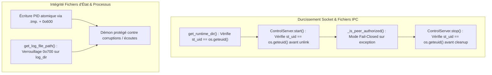

# Rapport de Session : Durcissement IPC, SO_PEERCRED Fail-Closed & Intégrité Système

- **Date** : 2026-10-17
- **Version** : `0.8.5`
- **Branche** : `feat/hardened-v2`
- **Auteur** : Agent IA Antigravity `[ai]`

---

## 1. Contexte & Demande Utilisateur

L'utilisateur a soumis pour audit et comparaison un patch proposé par GitHub Copilot sur la branche `feat/hardened++` (ou `feat/hard++`) :
> *"hum i got a patch from Copilot on github, the banch is `feat/hardened++` compare it to dev and tell what add in term of security and those changes are relevent enough to integrate"*

L'analyse approfondie a révélé :
1. **Un bug bloquant critique dans le patch Copilot** : La suppression accidentelle de `_is_peer_authorized` dans `control_server.py` provoquait un crash systématique du démon (`AttributeError`) lors de toute connexion CLI (`hyprsmart reload`, `hyprsmart status`, etc.).
2. **Des régressions de portabilité** : L'écrasement dur de `PATH` (`/usr/bin:/bin:/usr/local/bin`) cassait NixOS, Flatpak et les environnements virtuels Python, et la dépendance stricte imposée sur `pactl` empêchait le lancement sur les systèmes sans PulseAudio-utils.
3. **Quatre vraies pistes d'amélioration de sécurité** : L'écriture atomique du PID en `0o600`, l'isolation des logs en `0o700`, le contrôle d'appartenance `st_uid == os.geteuid()` sur le runtime/socket, et le passage de `SO_PEERCRED` en mode hermétique (*fail-closed*).

L'utilisateur a validé l'intégration assainie de ces quatre défenses sur le projet :
> *"oui oui"*

---

## 2. Architecture & Améliorations Implémentées



### 2.1 Authentification `SO_PEERCRED` Hermétique (*Fail-Closed*)
Dans [`src/hyprsmart/daemon/control_server.py`](../../src/hyprsmart/daemon/control_server.py) :
- Précédemment, si `getsockopt(SOL_SOCKET, SO_PEERCRED)` levait une exception `OSError` ou `struct.error`, la méthode retournait `True` (fail-open).
- Désormais, elle retourne formellement `False` (*fail-closed*) et utilise `os.geteuid()`. Toute connexion dont les accréditations noyau ne peuvent être prouvées de façon infalsifiable est instantanément rejetée.

### 2.2 Contrôle d'Appartenance sur le Runtime et le Socket UNIX
Dans [`src/hyprsmart/daemon/control_server.py`](../../src/hyprsmart/daemon/control_server.py) :
- `get_runtime_dir()` vérifie `st.st_uid == expected_uid` et lève une exception `PermissionError` si le répertoire est pré-créé par un autre utilisateur (protection anti-squatting / symlink).
- `ControlServer.start()` vérifie que le socket existant appartient bien à l'utilisateur courant avant d'appeler `unlink()`, évitant d'effacer le socket d'un autre processus utilisateur.

### 2.3 Écriture Atomique et Sécurisée du PID
Dans [`src/hyprsmart/cli.py`](../../src/hyprsmart/cli.py) :
- Le PID est écrit dans `hyprsmart.pid.tmp.<pid>`, verrouillé avec les permissions `0o600` (lecture/écriture propriétaire exclusif), puis déplacé atomiquement avec `replace(pid_file)`.

### 2.4 Isolation des Logs
Dans [`src/hyprsmart/cli.py`](../../src/hyprsmart/cli.py) :
- Le dossier `$XDG_STATE_HOME/hyprsmart/` reçoit explicitement les permissions `0o700` (`chmod 700`) à sa création, empêchant les autres utilisateurs de lire `hyprsmart.log`.

---

## 3. Validation par les Tests

4 nouveaux tests unitaires ont été ajoutés dans [`tests/test_security_hardening.py`](../../tests/test_security_hardening.py) :
1. `test_control_server_runtime_dir_ownership` : Vérifie que `get_runtime_dir()` lève une `PermissionError` si le dossier appartient à un autre UID (ex: 9999).
2. `test_control_server_stale_socket_ownership` : Vérifie que `start()` refuse de délier un socket appartenant à un autre UID.
3. `test_control_server_peer_cred_fail_closed` : Vérifie que `_is_peer_authorized()` retourne `False` en cas d'échec de `getsockopt`.
4. `test_log_dir_and_atomic_pid_permissions` : Vérifie les permissions `0o700` du dossier de logs.

**Bilan d'exécution** :
```text
Ran 64 tests in 22.752s
OK
```
Toutes les 64 épreuves de la suite de tests HyprSmart réussissent sans avertissement ni régression.
