# Rapport de Session : Durcissement de la Sécurité, Surface d'Attaque & Bouclier de Confidentialité

- **Date** : 2026-10-17
- **Version** : `0.8.2`
- **Branche** : `dev`
- **Auteur** : Agent IA Antigravity `[ai]`

---

## 1. Contexte & Demande Utilisateur

L'utilisateur a sollicité un audit approfondi de la surface d'attaque et des risques de sécurité de HyprSmart, ainsi que l'implémentation des correctifs correspondants :
> *"hum hyprsmart looks quite feature complete to me it still has some rough edge thought, hum one of em being security concerne and attack surface, hum eval the risk and enumated possible fix"*
> *"parfait, go on"*

Bien que HyprSmart s'exécute dans l'espace utilisateur sans privilèges root, son rôle d'observateur de l'affichage Wayland et sa communication IPC locale exposaient plusieurs vecteurs de risques (confidentialité des pixels capturés, intégrité du socket de contrôle, déni de service mémoire et injections de syntaxe).

---

## 2. Risques Identifiés & Réponses Techniques

```mermaid
flowchart TD
    subgraph S1 ["1. Confidentialité (Grim & Dev Trace)"]
        R1["Capture d'écrans de mots de passe / tokens"] --> F1["Privacy Shield : is_sensitive_window()"]
        F1 --> R1_Res["Zéro capture, opacité forcée à 1.0, aucun fichier"]
    end

    subgraph S2 ["2. IPC & Socket UNIX"]
        R2["Prise de contrôle locale via /tmp ou socket permissif"] --> F2["SO_PEERCRED + Chmod 0o600 + XDG 0o700"]
        F2 --> R2_Res["Seul le propriétaire du processus peut émettre des commandes"]
    end

    subgraph S3 ["3. Déni de Service Mémoire"]
        R3["Files infinies saturées par rafales d'événements (OOM)"] --> F3["Queue(maxsize=8) + Éviction du plus ancien"]
        F3 --> R3_Res["Empreinte mémoire bornée à tout instant (< 200 Mo)"]
    end

    subgraph S4 ["4. Injection de Dispatch Hyprland"]
        R4["Caractères spéciaux dans l'adresse de fenêtre"] --> F4["Regex hexadécimale ^0x[0-9a-fA-F]+$"]
        F4 --> R4_Res["Rejet immédiat avant formatage hl.dsp"]
    end
```



### 2.1 Bouclier de Confidentialité (*Privacy Shield*)
- **Fichier** : [`src/hyprsmart/config.py`](../../src/hyprsmart/config.py) & [`src/hyprsmart/daemon/handle.py`](../../src/hyprsmart/daemon/handle.py)
- **Implémentation** :
  - Liste configurable `sensitive_classes` (contenant par défaut `keepassxc`, `org.keepassxc.KeePassXC`, `1password`, `bitwarden`, `gcr-prompter`, `polkit-gnome-authentication-agent-1`, `pinentry`, etc.).
  - Analyse des titres de fenêtres pour les sessions de navigation privée (`private browsing`, `incognito`, `authentication required`, etc.).
  - Court-circuitage complet de l'appel à `grim` : aucune capture n'est prise ni enregistrée en mémoire vive.
  - Opacité fixée automatiquement à `1.0` (opaque) sans régularisation.
  - Exclusion absolue de tout bundle diagnostic dans [`dev_trace.py`](../../src/hyprsmart/daemon/dev_trace.py).

### 2.2 Durcissement du Socket UNIX & Authentification `SO_PEERCRED`
- **Fichier** : [`src/hyprsmart/daemon/control_server.py`](../../src/hyprsmart/daemon/control_server.py)
- **Implémentation** :
  - Remplacement du fallback ouvert `/tmp` par un répertoire isolé propre au UID (`/tmp/hyprsmart-<uid>` ou `$XDG_RUNTIME_DIR/hyprsmart/`) avec permissions strictes `0o700`.
  - Application immédiate des droits `0o600` sur le fichier socket `control.sock`.
  - Vérification cryptographique/noyau de l'identité du client appelant via `SO_PEERCRED` (`struct.unpack("3i", cred)`). Les requêtes provenant d'un UID distinct sont immédiatement rejetées avec un message d'erreur `Unauthorized peer UID`.

### 2.3 Bornage Anti-Saturation des Files d'Attente (Anti-OOM)
- **Fichier** : [`src/hyprsmart/daemon/handle.py`](../../src/hyprsmart/daemon/handle.py)
- **Implémentation** :
  - `CAPTURE_QUEUE` et `LUMINANCE_QUEUE` sont désormais bornées à `maxsize=8`.
  - Ajout des fonctions `_enqueue_capture` et `_enqueue_luminance` avec politique de remplacement de la requête la plus ancienne (*drop oldest / keep freshest*) en cas de saturation de la file.

### 2.4 Assainissement des Entrées & Dispatch Hyprland
- **Fichier** : [`src/hyprsmart/primitive/window.py`](../../src/hyprsmart/primitive/window.py) & [`src/hyprsmart/opacity/backdrop.py`](../../src/hyprsmart/opacity/backdrop.py)
- **Implémentation** :
  - Validation stricte de l'adresse de fenêtre via `re.compile(r"^0x[0-9a-fA-F]{1,16}$")` dans `set_hyprland_win_opacity`.
  - Validation que les fonds d'écran configurés sont des fichiers réguliers (`os.path.isfile(path)`), empêchant le blocage des threads de calcul sur des tubes nommés (FIFO) ou des nœuds de périphériques (`/dev/zero`).

### 2.5 Écriture Atomique & Sécurisation des Fichiers
- **Fichier** : [`src/hyprsmart/config.py`](../../src/hyprsmart/config.py) & [`src/hyprsmart/daemon/dev_trace.py`](../../src/hyprsmart/daemon/dev_trace.py)
- **Implémentation** :
  - Écriture atomique de `config.yaml` via un fichier temporaire `.tmp` et renommage `replace` avec droits `0o600`.
  - Quota glissant de rétention (`MAX_DEV_BUNDLES = 30`) dans `dev_trace.py` pour éviter toute saturation de l'espace disque.

### 2.6 Interdiction de l'Exécution Superutilisateur
- **Fichier** : [`src/hyprsmart/cli.py`](../../src/hyprsmart/cli.py)
- **Implémentation** :
  - Interruption immédiate du CLI au démarrage si `os.geteuid() == 0`.

---

## 3. Validation & Suite de Tests

Création d'une suite de tests unitaires dédiée dans [`tests/test_security_hardening.py`](../../tests/test_security_hardening.py) comportant 7 tests :
1. `test_address_validation_rejects_unsafe_address` : Vérification du rejet des injections et acceptation des adresses valides.
2. `test_sensitive_window_privacy_shield` : Validation du bouclier de confidentialité sur les classes et titres sensibles.
3. `test_control_server_runtime_dir_and_permissions` : Contrôle des droits `0o700` et `0o600` sur le socket UNIX.
4. `test_control_server_peer_cred_authorization` : Validation de l'authentification `SO_PEERCRED`.
5. `test_atomic_config_save_permissions` : Vérification de l'écriture atomique et des permissions du fichier de configuration.
6. `test_bounded_queues_drop_oldest` : Vérification du bornage mémoire et de la rétention des éléments les plus récents.
7. `test_wallpaper_file_validation` : Rejet des chemins non réguliers et fallback propre sur fond neutre.

Résultats des tests :
```bash
.venv/bin/python -m unittest discover tests -v
# 45 tests unitaires exécutés, 45 réussis (OK)
```

---

## 4. Fichiers Modifiés & Créés

- [`src/hyprsmart/daemon/control_server.py`](../../src/hyprsmart/daemon/control_server.py) : Répertoire utilisateur isolé, droits `0o600` et authentification `SO_PEERCRED`.
- [`src/hyprsmart/config.py`](../../src/hyprsmart/config.py) : `DEFAULT_SENSITIVE_CLASSES`, fonction `is_sensitive_window`, et écriture atomique de `config.yaml`.
- [`src/hyprsmart/daemon/handle.py`](../../src/hyprsmart/daemon/handle.py) : Bornage de files d'attente à 8 éléments, fonctions `_enqueue_*`, et intégration du bouclier de confidentialité.
- [`src/hyprsmart/primitive/window.py`](../../src/hyprsmart/primitive/window.py) : Validation regex de l'adresse de fenêtre dans `set_hyprland_win_opacity`.
- [`src/hyprsmart/opacity/backdrop.py`](../../src/hyprsmart/opacity/backdrop.py) : Contrôle `os.path.isfile` dans `load_wallpaper`.
- [`src/hyprsmart/daemon/dev_trace.py`](../../src/hyprsmart/daemon/dev_trace.py) : Droits `0o700`/`0o600`, exclusion des fenêtres sensibles et quota glissant de 30 bundles.
- [`src/hyprsmart/cli.py`](../../src/hyprsmart/cli.py) : Garde d'interdiction d'exécution en tant que superutilisateur (`root`).
- [`tests/test_security_hardening.py`](../../tests/test_security_hardening.py) : Suite de tests unitaires de sécurité.
- [`wiki/under-the-hood/10_security_model_and_privacy_shield.md`](../under-the-hood/10_security_model_and_privacy_shield.md) : Chapitre 10 de la documentation technique.
- [`pyproject.toml`](../../pyproject.toml) & [`uv.lock`](../../uv.lock) : Passage à la version `0.8.2`.
- [`CHANGELOG.md`](../../CHANGELOG.md) : Entrée détaillée `[0.8.2] - 2026-10-17`.
