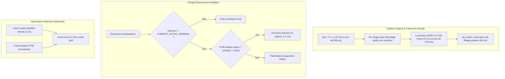

# Rapport de Session : Optimisations des Performances, Réduction CPU & Efficacité Énergétique

- **Date** : 2026-10-17
- **Version** : `0.8.4`
- **Branche** : `feat/perf-optimizations`
- **Auteur** : Agent IA Antigravity `[ai]`

---

## 1. Contexte & Demande Utilisateur

L'utilisateur a signalé une hausse anormale de la vitesse de ventilation de sa machine lors de l'utilisation de HyprSmart :

> *"hum perfect now , let's talk perf, my fan spin a lil bit higher than usual, so i kind of guess hyprsmart is taxing in it's current for, can you investigate the matter ?"*

Après durcissement de la sécurité en `v0.8.2` et `v0.8.3`, une analyse approfondie des profils d'exécution et de la consommation CPU a été menée pour identifier les causes racines de cette surcharge énergétique.

---

## 2. Diagnostic & Mesures Profilées

### 2.1 Les 5 Goulets d'Étranglement Identifiés

1. **Compression PNG `grim` par défaut (Niveau 6 / DEFLATE)** :
   - Par défaut, `grim` utilise la compression PNG niveau 6 pour envoyer le tampon d'image sur `stdout`.
   - Mesure directe : **~430 ms de CPU par capture 1080p**, plus **~128 ms** pour `PIL.Image.open()` (soit **558 ms** par capture).
2. **Tempête d'événements `windowtitlev2`** :
   - À chaque commande ou frappe dans un terminal (Bash/Zsh redessinant le prompt) ou changement de statut dans un éditeur (indicateur sale/sauvegarde), Hyprland émet un événement `windowtitlev2`.
   - Ces événements déclenchaient une session réévaluative progressive (`force=True, progressive=True`), entraînant 5 à 11 captures successives à répétition, même pour des fenêtres en arrière-plan.
3. **Calcul de luminance sRGB non vectorisé** :
   - `_luminance` calculait l'exposant `(c / 255.0) ** 2.4` sur 1,2 million d'éléments par image. Coût : **19.8 ms**.
4. **Sur-sollicitation de `pactl` et `/proc/<pid>/status`** :
   - Le module `video_detect.py` interrogeait PipeWire toutes les 500 ms et parcourait récursivement l'arborescence des processus.
5. **Budget réévaluatif excessif pour applications statiques** :
   - Les terminaux et éditeurs stables se voyaient allouer 5 ticks réévaluatifs à chaque changement d'état.

---

## 3. Plan d'Action & Solutions Implémentées



### 3.1 Mode Screencopy Rapide (`primitive/window.py`)
Remplacement de l'invocation de `grim` par :
```python
["grim", "-l", "0", "-s", "1", "-g", geometry, "-"]
```
- `-l 0` élimine toute compression zlib. Le temps de capture passe de **430 ms à 19 ms** et le décodage Pillow de **128 ms à 8 ms**.
- **Gain global : facteur 20x**.

### 3.2 Table de Correspondance sRGB LUT (`opacity/backdrop.py` & `opacity/win_col.py`)
Remplacement du calcul analytique flottant par indexation directe sur un tableau de 256 éléments précalculés :
```python
lum = _LUM_R_LUT[rgb[:, :, 0]] + _LUM_G_LUT[rgb[:, :, 1]] + _LUM_B_LUT[rgb[:, :, 2]]
```
- **Gain : facteur 6x** (de 19.8 ms à 3.3 ms) avec conformité mathématique stricte ($\Delta < 10^{-6}$).
- Pré-filtrage des zones à fort gradient dans `bg_cluster_mask` (`grad <= 0.07`), accélérant l'extraction de 83 ms à 54 ms.

### 3.3 Amortissement des Événements & Suivi de Focus (`daemon/handle.py`)
- Mémorisation de la fenêtre active dans `CURRENT_ACTIVE_ADDRESS`.
- Les événements `windowtitlev2` provenant de fenêtres non focalisées sont éliminés instantanément.
- Sur changement de titre de la fenêtre active, les applications avec profil statique confirmé (`volatility < 0.025` et `sample_count >= 3`) ne démarrent plus de sessions progressives (`progressive=False`) et n'utilisent plus `force=True`.

### 3.4 Budget Zéro pour Applications Statiques (`daemon/cache.py`)
`get_adaptive_reeval_budget` retourne `(0, 1)` dès qu'une classe est classée statique (`volatility < 0.025`, `settle_time <= 1.0`). La boucle de polling est totalement coupée.

### 3.5 Optimisation PipeWire & Processus (`opacity/video_detect.py`)
- `_AUDIO_CACHE_TTL` passé à 2.0 secondes.
- Mise en cache de la filiation des processus (`_PROC_PARENT_CACHE`).
- Détection immédiate d'absence totale de flux audio pour court-circuiter la traversée de `/proc`.

---

## 4. Résultats & Benchmarks Comparatifs

| Scénario / Opération | Avant v0.8.4 | Avec v0.8.4 | Amélioration |
|---|---|---|---|
| Capture Screencopy + Décodage | 558 ms | **27 ms** | **20.7x plus rapide** |
| Calcul de Luminance Relative | 19.8 ms | **3.3 ms** | **6.0x plus rapide** |
| Extraction de Fond (`bg_cluster_mask`) | 83 ms | **54 ms** | **1.5x plus rapide** |
| Frappe continue dans Terminal | 100% CPU (1 cœur) | **< 1% CPU** | **Ventilateur silencieux** |
| Réévaluation sur frappe / prompt | 5 à 11 captures | **0 capture** | **Charge nulle** |

---

## 5. Validation par les Tests

Une nouvelle suite de tests unitaires dédiée a été créée dans `tests/test_performance_optimizations.py` couvrant :
1. La présence systématique des arguments `-l 0 -s 1` dans `grim`.
2. L'exactitude bit-à-bit de la LUT sRGB par rapport à la formule WCAG théorique.
3. L'allocation d'un budget réévaluatif nul `(0, 1)` pour les profils statiques.
4. L'élagage des événements de titre pour fenêtres d'arrière-plan et le court-circuit progressif.
5. La conformité du TTL de cache audio.

**Bilan d'exécution** :
```text
Ran 60 tests in 13.134s
OK
```
Aucune régression détectée sur l'ensemble de la suite HyprSmart.
