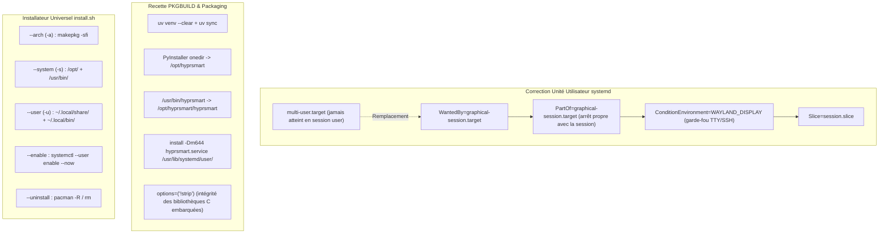

# Rapport de Session : Packaging Arch Linux, Résolution Démon systemd & Installateur Universel

- **Date** : 2026-10-19
- **Version** : `0.8.6`
- **Branche** : `dev`
- **Auteur** : Agent IA Antigravity `[ai]`

---

## 1. Contexte & Demande Utilisateur

L'utilisateur travaillait sur le packaging initial de HyprSmart pour Arch Linux et rencontrait un blocage critique :
> *"Gemini, im currently trying to package the project primarly for arch linux on the moment, but i get stuck with an issue with .service file as event thought it is where it should, be the deamon is never started. plus update the revelant docs and an install.sh"*

Les objectifs de la session comprenaient :
1. Diagnostiquer et corriger le dysfonctionnement de l'unité systemd `hyprsmart.service` qui empêchait le démon de se lancer automatiquement bien que le fichier soit à l'emplacement attendu.
2. Assainir et fiabiliser la recette de fabrication de paquet Arch Linux (`packaging/arch/PKGBUILD`).
3. Créer un script d'installation automatisé universel (`install.sh`) prenant en charge les modes Arch Linux, installation système globale et installation locale non-root, avec options de démarrage immédiat du service (`--enable`) et de désinstallation propre (`--uninstall`).
4. Mettre à jour la documentation (`README.md`, `docs/wiki/`) et le journal des modifications (`CHANGELOG.md`).
5. Incrémenter la version du projet vers `0.8.6` et valider l'intégrité de la suite de tests.

---

## 2. Diagnostic & Cause Racine : Le Piège de `multi-user.target` en Espace Utilisateur

### 2.1 Analyse de la Défaillance
Le fichier `packaging/arch/hyprsmart.service` initial contenait la section d'installation suivante :
```ini
[Install]
WantedBy=multi-user.target
```

Or, dans l'instance utilisateur systemd (`systemctl --user`) :
1. **Inexistence de la cible** : `multi-user.target` est une cible réservée au démarrage global du système (PID 1 système). Dans la session utilisateur, cette cible **n'est jamais déclenchée ni évaluée**.
2. **Lien symbolique orphelin** : Lors de l'activation via `systemctl --user enable hyprsmart.service`, systemd créait bien le lien dans :
   `~/.config/systemd/user/multi-user.target.wants/hyprsmart.service`
3. **Session ignorée** : À la connexion de l'utilisateur sur Hyprland, systemd charge la cible de session graphique `graphical-session.target`. Ne voyant aucun lien dans `graphical-session.target.wants/`, systemd ne démarrait jamais le démon `hyprsmart`.

### 2.2 Défauts Secondaires Identifiés
- **`PKGBUILD` exécutait `systemctl enable --user` dans `package()`** : Cette pratique viole les règles de packaging Arch Linux et échoue en environnement de compilation sandboxé / chroot (`fakeroot`) sans bus D-Bus.
- **Absence de condition d'environnement** : Sans `ConditionEnvironment=WAYLAND_DISPLAY`, le service risquait de tenter de s'exécuter sur un TTY console ou une session SSH sans serveur d'affichage Wayland, entraînant des échecs en boucle.
- **Pollution git** : Des artefacts temporaires de compilation makepkg (`packaging/arch/src/`, `packaging/arch/pkg/`, archives `.tar.gz`) avaient été accidentellement suivis dans l'index git lors de la restructuration du dépôt.

---

## 3. Solutions Apportées & Implémentation



### 3.1 Unité systemd Utilisateur Corrigée (`packaging/arch/hyprsmart.service`)
```ini
[Unit]
Description=HyprSmart - Adaptive window transparency for Hyprland
Documentation=https://github.com/ctlinker/hyprsmart
PartOf=graphical-session.target
After=graphical-session.target
ConditionEnvironment=WAYLAND_DISPLAY

[Service]
Type=simple
ExecStart=/usr/bin/hyprsmart start --foreground
Restart=on-failure
RestartSec=2
Slice=session.slice

[Install]
WantedBy=graphical-session.target
```

### 3.2 Paquet Arch Linux `PKGBUILD` Assaini
- Le fichier d'unité est désormais copié statiquement dans le répertoire standard des unités utilisateur système :
  `install -Dm644 packaging/arch/hyprsmart.service "$pkgdir/usr/lib/systemd/user/hyprsmart.service"`
- L'option `options=('!strip')` a été ajoutée pour empêcher l'altération des bibliothèques binaires C et symboles nécessaires au runtime PyInstaller.
- Le fichier `.gitignore` a été complété pour exclure systématiquement `packaging/arch/pkg/`, `packaging/arch/src/`, `packaging/arch/*.pkg.tar.*` et `packaging/arch/*.tar.gz`.

### 3.3 Script d'Installation Universel (`install.sh`)
Création d'un script bash interactif et non-interactif supportant :
- `./install.sh --arch --enable` : Crée une archive locale via `git archive`, exécute `makepkg -sfi` et active le service systemd.
- `./install.sh --system --enable` : Compile via `uv run python -m PyInstaller` et installe globalement sous `/opt/hyprsmart/`, `/usr/bin/hyprsmart` et `/usr/lib/systemd/user/hyprsmart.service`.
- `./install.sh --user --enable` : Compile et installe en espace utilisateur pur sous `~/.local/share/hyprsmart/`, `~/.local/bin/hyprsmart` et `~/.config/systemd/user/hyprsmart.service` sans aucune élévation de privilèges (sans `sudo`).
- `./install.sh --uninstall` : Détection automatique du type d'installation, arrêt du démon, suppression des unités et nettoyage des fichiers.

### 3.4 Support de l'Option `--version` (`v0.8.6`)
- Ajout de `VERSION = "0.8.6"` dans `hyprsmart/src/hyprsmart/cli.py` et export de `__version__` dans `hyprsmart/src/hyprsmart/__init__.py`.
- Intégration des arguments `-v` et `--version` dans le parseur principal `argparse`.
- Synchronisation des versions dans `pyproject.toml`, `uv.lock` et `PKGBUILD`.
- Ajout d'un test unitaire dans `test_control_server.py` validant l'option CLI `--version`.

---

## 4. Documentation Technique Réalisée

1. **`README.md`** :
   - Refonte de la section *Installation & Requirements* détaillant les trois méthodes : Arch Linux natif, script universel `install.sh`, et environnement virtuel `uv`.
   - Documentation du double choix de démarrage automatique : service utilisateur systemd (`systemctl --user enable --now hyprsmart.service`) ou configuration Hyprland (`exec-once = hyprsmart start`).
   - Correction des liens relatifs vers `docs/wiki/`.
2. **Wiki Technique (`docs/wiki/under-the-hood/12_packaging_and_systemd_daemon.md`)** :
   - Rédaction du chapitre 12 détaillant l'architecture d'empaquetage, la séparation des cibles systemd et les spécificités de la session graphique Wayland.
   - Mise à jour de `docs/wiki/README.md` et `docs/wiki/under-the-hood/README.md`.
3. **`CHANGELOG.md`** :
   - Rédaction complète des entrées de version `[0.8.6] - 2026-10-19` en français.

---

## 5. Validation & Tests

1. **Test en direct du service systemd sur la machine** :
   - Désactivation de l'ancien lien `multi-user.target.wants/hyprsmart.service`.
   - Activation et démarrage de la nouvelle unité avec `systemctl --user enable --now hyprsmart.service`.
   - **Résultat** : Démon immédiatement actif (`Active: active (running)`), socket IPC fonctionnel (`~/.local/state/hyprsmart/control.sock`), opacité appliquée avec succès.
2. **Suite de tests unitaires** :
   - Exécution de l'ensemble des suites de tests sous Python 3.14 (`cd hyprsmart && uv run python -m unittest discover tests`).
   - **Résultat** : 65 tests exécutés, 65 tests validés avec succès (0 échec, 0 régression) en ~3.4 secondes.
3. **Exécution du script `install.sh`** :
   - `./install.sh --help` vérifié et fonctionnel.
