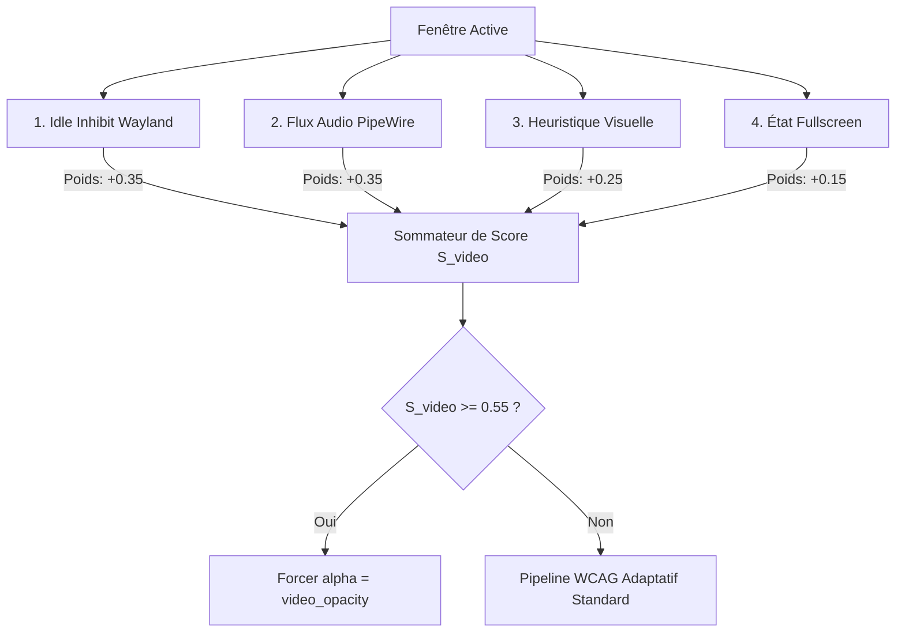

# Détection Multi-Signaux de Vidéo & Règle d'Opacité Dédiée

La transparence adaptative basée sur le contraste WCAG statique convient parfaitement aux éditeurs de code, terminaux et pages web textuelles. En revanche, **la lecture vidéo** constitue un cas limite fondamental pour les modèles de contraste statique :
1. Une scène cinématographique ou vidéo présente un contenu visuel continuellement en mouvement.
2. La transparence superpose les motifs du fond d'écran à travers les ombres et dégrade dramatiquement le contraste perçu des scènes sombres.
3. Les visages et éléments visuels perdent leur intégrité colorimétrique.

Pour remédier à cela, HyprSmart intègre un **détecteur multi-signaux déterministe** qui identifie avec certitude les flux vidéo actifs sans analyse d'image par réseau de neurones lourd.

---

## 1. Les 4 Signaux Déterministes

Plutôt que de se fier à une seule source de données faillible, HyprSmart interroge 4 couches indépendantes du système :



### 1.1. Invalidation de Veille Wayland (`idle_inhibit`) — Poids $+0.35$
Les navigateurs (Firefox, Chromium) et les lecteurs multimédias (MPV, VLC) activent le protocole Wayland `ext-idle-inhibit-v1` ou `org_kde_kwin_idle_timeout` dès qu'une vidéo commence à jouer afin d'empêcher l'écran de se verrouiller ou de s'éteindre.
Hyprland expose directement cet état via son IPC :
```json
{
  "address": "0x5630fc98e320",
  "inhibitingIdle": true
}
```
Si `inhibitingIdle` est `true`, le signal vaut **$+0.35$**.

### 1.2. Flux Audio PipeWire / PulseAudio (`audio_active`) — Poids $+0.35$
Un flux vidéo s'accompagne quasi-systématiquement d'une piste audio active.
HyprSmart interroge le serveur de son via `pactl --format=json list sink-inputs` :
- Vérification de l'état du flux : les entrées en état `CORKED` (en pause) ou `Mute: yes` sont ignorées.
- Récupération du PID de l'application cliente : champ `properties["application.process.id"]`.
- Résolution de l'arbre généalogique `/proc/<pid>/status` :
  Dans les navigateurs modernes multiprocessus, le processus audio/médias (ex: `Isolated Web Co` ou `RDD Process` sous Firefox) est souvent un sous-processus descendant du processus principal de la fenêtre. HyprSmart remonte récursivement la chaîne des parents (`PPid`) pour matcher le PID de la fenêtre active.
Si un flux audio non-suspendu est rattaché à la fenêtre, le signal vaut **$+0.35$**.

### 1.3. Heuristique Visuelle de Scène (`visual_video`) — Poids $+0.25$
À partir de la vignette capturée analysée par `WindowVisuals` :
- $R_{bg}$ (taux de fond uni) : une vidéo pleine fenêtre ne comporte aucun fond uni prédominant ($R_{bg} < 0.40$).
- $D_{text}$ (densité textuelle) : contrairement à un éditeur de texte où les glyphes abondent ($D_{text} > 0.20$), une vidéo comporte très peu de contours textuels continus ($D_{text} < 0.20$), sauf sous-titres discrets.
Si ces conditions sont satisfaites, le signal vaut **$+0.25$**.

### 1.4. Mode Plein Écran (`fullscreen`) — Poids $+0.15$
Exposé par Hyprland (`win.fullscreen` ou `fullscreenClient`), ce signal indique un mode d'immersion typique du visionnage vidéo ou gaming. Il contribue à hauteur de **$+0.15$**.

---

## 2. Règle de Décision & Matrice de Vérité

Le score composite est défini par :
$$S_{video} = w_{idle} \cdot I_{idle} + w_{audio} \cdot I_{audio} + w_{vis} \cdot I_{vis} + w_{fs} \cdot I_{fs}$$
avec le seuil de décision :
$$\text{is\_video} = (S_{video} \ge 0.55)$$

| Scénario Utilisateur | `idle_inhibit` (0.35) | `audio_active` (0.35) | `visual_video` (0.25) | `fullscreen` (0.15) | Score $S_{video}$ | Résultat |
| :--- | :---: | :---: | :---: | :---: | :---: | :--- |
| **YouTube avec audio** | $\checkmark$ | $\checkmark$ | $\checkmark$ | — | **$0.95$** | **Vidéo** ($\alpha = \text{video\_opacity}$) |
| **Vidéo en mode muet** | $\checkmark$ | $\times$ | $\checkmark$ | — | **$0.60$** | **Vidéo** ($\alpha = \text{video\_opacity}$) |
| **Lecteur MPV Plein Écran** | $\checkmark$ | $\checkmark$ | $\checkmark$ | $\checkmark$ | **$1.00$** | **Vidéo** ($\alpha = \text{video\_opacity}$) |
| **Spotify (musique seule)** | $\times$ | $\checkmark$ | $\times$ | — | **$0.35$** | **Non-vidéo** (transparence normale WCAG) |
| **Galerie de photos web** | $\times$ | $\times$ | $\checkmark$ | — | **$0.25$** | **Non-vidéo** (transparence normale WCAG) |
| **Terminal / IDE avec musique de fond** | $\times$ | $\times$ (autre PID) | $\times$ | — | **$0.00$** | **Non-vidéo** (transparence normale WCAG) |

---

## 3. Pilotage Dynamique : `video_opacity`

L'opacité appliquée aux fenêtres qualifiées de vidéo est pilotable sans redémarrage via la commande :
```bash
hyprsmart settings video_opacity 0.98
```
La valeur est immédiatement enregistrée dans `~/.config/hyprsmart/config.yaml` et injectée via le socket UNIX `control.sock` dans le démon en mémoire, recalculant instantanément l'opacité de la fenêtre active.
