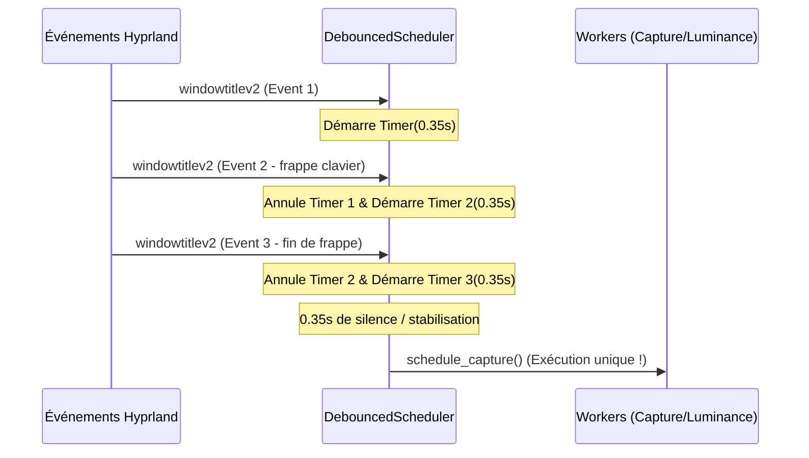

# Caching Dynamique, Exécution Différée & Préservation des Snapshots

Ce document détaille les mécanismes d'ordonnancement temporel, de mise en cache hiérarchique et d'anti-contamination optique introduits pour fiabiliser l'exécution de HyprSmart en conditions réelles d'utilisation.

---

## 1. La Problématique de la Capture en Environnement Dynamique

Dans un gestionnaire de fenêtres en mosaïque (tiling WM) comme Hyprland, les événements surviennent fréquemment en rafale :
- Frappe au clavier dans un terminal : chaque commande ou changement de dossier met à jour le titre de la fenêtre (`windowtitlev2`).
- Démarrage d'une application : entre l'émission de `openwindow` et l'affichage complet de l'interface graphique (splash screen, fenêtre blanche temporaire, chargement des composants), plusieurs centaines de millisecondes s'écoulent.
- Déplacement ou redimensionnement d'une fenêtre : envoi continu d'événements de géométrie.

Sans régulation intelligente, deux écueils majeurs apparaissent :
1. **La capture prématurée** : photographier une fenêtre avant que ses composants ne soient peints (capture d'un aplat blanc ou noir) pollue le cache avec des luminances erronées.
2. **La tempête de recalculs** : chaque frappe au clavier déclenche des captures synchrones lourdes par `grim`, entraînant des saccades du système.

---

## 2. Ordonnanceur à Temporisation Glissante (`DebouncedScheduler`)

Pour résoudre la saturation, HyprSmart remplace les temporisateurs rigides par un ordonnanceur à **temporisation glissante (trailing debounce)** avec annulation active :



### Délais Adaptatifs par Nature d'Événement
- `activewindowv2` (changement de focus) : **$0.15$ s** (priorité à la réactivité utilisateur).
- `windowtitlev2` (frappe, onglet) : **$0.35$ s** après le dernier événement (attend la stabilisation).
- `openwindow` (lancement d'appli) : **$0.70$ s** (laisse le temps à l'interface de se dessiner).
- `fullscreen`, `movewindowv2` : **$0.20$ s**.

---

## 3. Anti-Contamination de Transparence (Snapshot Propre)

### Le Problème de la Capture Composite
La commande `grim` effectue une capture de la sortie rendue par le compositeur Wayland. Si une fenêtre est déjà rendue transparente avec une opacité $\alpha < 1.0$, `grim` capture un mélange linéaire des pixels de la fenêtre et du fond d'écran sous-jacent :
$$I_{grim} = \alpha \cdot I_{window} + (1 - \alpha) \cdot I_{wallpaper}$$

Si HyprSmart analyse cette capture pour recalculer l'opacité, la luminance mesurée de la fenêtre est polluée par celle du fond d'écran. Cela crée une boucle de rétroaction cumulative instable où la fenêtre devient de plus en plus sombre ou de plus en plus claire.

### La Solution : Restauration Transitoire à 1.0
Lorsqu'une re-capture physique est strictement nécessaire sur une fenêtre déjà rendue transparente ($\alpha < 0.99$) :
1. HyprSmart réinitialise brièvement l'opacité à $1.0$ via `hyprctl dispatch`.
2. Une micro-temporisation de $20$ ms permet au compositeur de peindre l'image opaque.
3. `grim` capture l'image pure de l'application ($I_{window}$).
4. Le moteur calcule et applique immédiatement la nouvelle opacité optimale.

---

## 4. Cache Hiérarchique à Deux Niveaux & Apprentissage Dynamique

Pour minimiser les captures d'écran et éviter d'avoir recours au flash transitoire à 1.0, HyprSmart implémente une hiérarchie de cache à deux niveaux **entièrement dynamique (zéro configuration codée en dur)** :

```mermaid
graph TD
    A[Demande d'Opacité pour Window] --> B{Cache Instance WIN_CACHE ?<br/>(address + title exact, TTL 30 min)}
    B -- Hit --> C[Utiliser Visuals d'Instance]
    B -- Miss --> D{Cache de Classe CLASS_CACHE ?<br/>(win.window_class)}
    D -- Hit --> E[Utiliser Visuals de Classe dynamiques]
    D -- Miss --> F[Capture d'écran physique grim]
    F --> G[Enregistrer dans WIN_CACHE]
    F --> H[Mémoriser la classe dans CLASS_CACHE]
```

- **Niveau 1 (`WIN_CACHE`)** : Clé par adresse de fenêtre et titre exact. Sa durée de vie est étendue à **30 minutes** (au lieu de 30 secondes).
- **Niveau 2 (`CLASS_CACHE`)** : Clé par classe d'application (`win.window_class`). Dès qu'une application (ex: `foot`, `kitty`, `vscodium`, `firefox`) est capturée une seule fois, son profil visuel (`text_l`, `bg_l`, `text_density`, `bg_ratio`) est mémorisé pour sa classe.
  - Lorsqu'un terminal ou un éditeur change de titre lors d'une frappe, le niveau 1 est un miss mais le niveau 2 est un **hit immédiat**.
  - **Aucune re-capture n'est déclenchée** : l'opacité est calculée en mémoire en moins de 1 ms.

---

## 5. Diffing d'Opacité & Seuil de Tolérance ($\Delta \alpha < 0.03$)

Même lorsqu'un recalcul a lieu (par exemple lors du déplacement d'une fenêtre sur une zone similaire du fond d'écran), envoyer une commande IPC `hyprctl dispatch` à chaque milliseconde consomme inutilement du temps CPU et sollicite le compositeur.

HyprSmart conserve l'opacité actuellement appliquée (`last_alpha`) pour chaque fenêtre gérée :
$$\Delta \alpha = |\alpha_{ideal} - \alpha_{current}|$$

- **Si $\Delta \alpha < 0.03$** : L'opacité actuelle est jugée déjà optimale pour le fond d'écran. La commande de dispatch est **court-circuitée (no-op)**.
- **Si $\Delta \alpha \ge 0.03$** : La nouvelle opacité est appliquée et consignée.

Ce diffing élimine les micro-scintillements et allège considérablement la charge globale du système.
