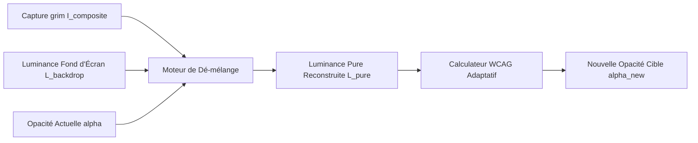

# Dé-mélange Optique (Optical Unblending) & Profils Génériques de Classe

Ce document détaille la théorie physique, la formulation mathématique et l'intégration du **dé-mélange optique (deconvolution)** et des **profils génériques de classe** dans HyprSmart.

---

## 1. La Problématique de l'Alpha Compositing Direct

Dans un environnement de bureau avec transparence active, la capture d'écran fournie par l'outil de composition (via `grim`) ne contient pas l'image pure de l'application $I_{window}$, mais le résultat du mélange optique (alpha compositing) :
$$I_{composite} = \alpha \cdot I_{window} + (1 - \alpha) \cdot I_{backdrop}$$

où :
- $\alpha \in [0.0, 1.0]$ est l'opacité actuellement appliquée à la surface Wayland.
- $I_{backdrop}$ est l'image du fond d'écran située géométriquement sous la fenêtre.
- $I_{composite}$ est le rendu résultant capturé par `grim`.

### Les Écueils des Approches Précédentes
1. **La contamination directe** : analyser $I_{composite}$ sans correction prend les couleurs du fond d'écran pour celles de la fenêtre. Si le fond d'écran est très clair, un terminal noir transparent apparaît gris ou blanc dans la capture, induisant une décision d'opacité erronée.
2. **Le clignotement transitoire (flash à 1.0)** : forcer temporairement l'opacité à $1.0$ pendant quelques millisecondes pour capturer la fenêtre opaque élimine la contamination, mais produit un micro-scintillement visuel désagréable pour l'utilisateur.
3. **Le blindage excessif du cache** : figer le profil d'une application sur sa première capture empêche le système de voir les changements réels de contenu (ex: passage d'un site sombre à une page web blanche dans un navigateur), rendant HyprSmart inerte et imperceptible.

---

## 2. Dé-mélange Optique (Inversion Mathématique)

Puisque HyprSmart contrôle l'opacité appliquée $\alpha$ et connaît la carte de luminance du fond d'écran sous-jacent $L_{backdrop}$ (extraite par `backdrop_behind`), nous pouvons inverser mathématiquement le mélange sans jamais modifier l'affichage ni faire clignoter l'écran :

$$L_{pure} = \frac{L_{captured} - (1 - \alpha) \cdot L_{backdrop}}{\alpha}$$

### Bornage Numérique Sécurisé
Pour éviter toute singularité ou division par zéro si $\alpha$ est très bas, nous utilisons une opacité de sécurité $\alpha_{safe} = \max(0.20, \alpha)$ et bornons la luminance résultante dans l'espace physique sRGB $[0.0, 1.0]$ :
$$L_{unblended} = \text{clamp}\left(\frac{L_{captured} - (1 - \alpha_{safe}) \cdot L_{backdrop}}{\alpha_{safe}}, 0.0, 1.0\right)$$

---

## 3. Profils Génériques de Classe & Régularisation

Lorsque l'opacité de la fenêtre est faible ($\alpha \approx 0.40 - 0.60$), le fond d'écran représente une part prépondérante du signal lumineux capturé. Pour immuniser le calcul contre les fluctuations locales de bruit, HyprSmart maintient un **profil de référence générique par classe d'application** (`CLASS_PROFILES[window_class]`).

### Apprentissage Dynamique par Moyenne Mobile (EMA)
À chaque observation valide, le profil générique de la classe est actualisé selon une moyenne mobile exponentielle (EMA) :
$$P_{class}^{(t)} = 0.70 \cdot P_{class}^{(t-1)} + 0.30 \cdot P_{obs}$$

Ce profil conserve l'empreinte visuelle typique de l'application (ex: un terminal a un fond moyen sombre $L_{bg} \approx 0.04$ et un texte clair $L_{text} \approx 0.90$).

### Régularisation Adaptative
Si un profil de classe $L_{class\_ref}$ est disponible, la luminance finale est pondérée en fonction du niveau de transparence :
$$w_{ref} = \max\left(0.0, \min\left(0.35, (0.80 - \alpha_{safe}) \cdot 0.5\right)\right)$$
$$L_{final} = (1 - w_{ref}) \cdot L_{unblended} + w_{ref} \cdot L_{class\_ref}$$

- Si $\alpha \ge 0.80$ : $w_{ref} = 0$, le dé-mélange pur est utilisé à $100\%$.
- Si $\alpha$ descend vers $0.40$ : le profil de classe intervient comme point d'ancrage jusqu'à $20\%$, garantissant une parfaite stabilité.

---

## 4. Persistance des Profils (`profiles.json`) & Préchargement au Démarrage

### Sauvegarde Atomique dans `~/.config/hyprsmart/profiles.json`
Les profils de classe appris par EMA sont persistés sur disque au format JSON. Chaque mise à jour d'un profil écrit d'abord dans un fichier temporaire `.profiles.json.tmp` avant d'être substituée de manière atomique, prévenant toute corruption en cas d'arrêt imprévu.

### Préchargement Universel (`preload_all_windows`)
Au démarrage du démon, la fonction `preload_all_windows()` :
1. Interroge l'ensemble des fenêtres Wayland mappées sur tous les espaces de travail et moniteurs via `get_hyprland_windows()`.
2. Pour chaque fenêtre dont la classe est connue dans `profiles.json`, extrait la géométrie $(x, y, w, h)$ et découpe la portion correspondante du fond d'écran.
3. Calcule l'opacité requise via `decide_opacity(profile, backdrop)` et l'applique immédiatement via `set_hyprland_win_opacity`.
4. **Bénéfice utilisateur** : Les fenêtres préexistantes sur tous les bureaux sont immédiatement adaptées et transparentes dès le lancement de HyprSmart, sans avoir à les focaliser une par une.

---

## 5. Réactivité Dynamique aux Changements de Contenu

Grâce au dé-mélange optique :
- **Changement d'onglet web ou de thème** : l'événement `windowtitlev2` déclenche après $0.25$ s une capture directe (sans flash). Le dé-mélange reconstruit instantanément la nouvelle luminance du fond ($L_{bg} = 0.05 \to 0.95$).
- **Calcul de contraste instantané** : le moteur WCAG adapte l'opacité à la hausse ou à la baisse selon le nouveau contraste requis.
- **Transparence vivante et perceptible** : HyprSmart s'adapte en temps réel aux déplacements, redimensionnements et changements de focus sans perturber la lisibilité.

