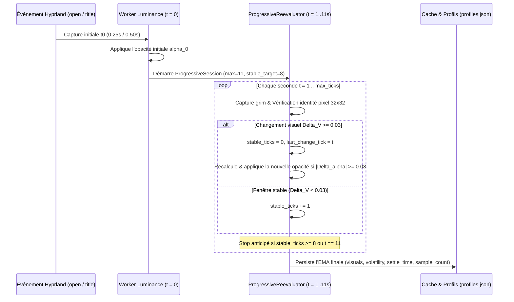

# 09. Réévaluation Progressive & Profils Dynamiques Émergents

Ce document détaille le moteur de **réévaluation progressive annulable** (`ProgressiveReevaluator`) et l'apprentissage automatique de **profils temporels dynamiques** par classe d'application (`volatility`, `settle_time`, `sample_count`).

---

## 1. La Problématique des Fenêtres à Chargement Asynchrone

Dans un compositeur Wayland en temps réel, de nombreuses applications ne stabilisent pas leur rendu visuel immédiatement après l'émission d'un événement `openwindow` ou `windowtitlev2` :
- **Navigateurs web (Firefox, Zen, Chromium)** : La balise `<title>` est souvent mise à jour dès les premières $100\text{–}200\text{ ms}$ de la navigation, alors que la fenêtre affiche encore un écran de transition sombre/blanc, un *skeleton loader*, ou l'ancienne page pendant $1$ à $6$ secondes (latence réseau, hydratation JavaScript, chargement d'images).
- **Applications Electron / WebViews (Discord, Spotify, VSCode)** : Affichent fréquemment un écran d'accueil (*splash screen*) statique pendant plusieurs secondes avant de peindre l'interface finale.

Une capture unique déclenchée à $t_0 = 0.25\text{ s}$ fige alors l'état transitoire dans le cache pour 30 minutes sans jamais réévaluer la fenêtre une fois la page véritablement chargée.

---

## 2. Boucle de Réévaluation Progressive Annulable (`11` ticks, arrêt anticipé à `8` stables)

Pour concilier **réactivité instantanée** et **convergence asynchrone**, HyprSmart associe l'évaluation initiale rapide ($t_0$) à une session d'échantillonnage progressif cadencée toutes les `1.0s` (`reeval_interval`) :

### Pourquoi un seuil de stabilité de $K = 8$ secondes sur $11$ par défaut ?
Lors du chargement d'un site web lourd, l'écran peut demeurer totalement immobile pendant $2$ à $4$ secondes (attente réseau/DNS ou exécution du bundle JS) avant de basculer brusquement vers la page finale. Un seuil d'arrêt anticipé trop court ($K = 2$) interromprait la surveillance pendant ce plateau d'attente. Avec `reeval_max_ticks = 11` et `reeval_stable_ticks = 8`, HyprSmart traverse sans faillir les plateaux de chargement tout en s'arrêtant automatiquement dès que l'affichage est véritablement stabilisé.

### Annulation Immédiate sur Événement Concurrent
La session progressive en cours est immédiatement annulée si :
- L'utilisateur change de fenêtre active (`activewindowv2` sur une autre adresse),
- La fenêtre est fermée (`closewindow`),
- Un nouveau changement de titre (`windowtitlev2`) relance un cycle complet depuis $t_0$,
- Un flux vidéo actif est détecté par [`evaluate_video_score`](../../src/hyprsmart/opacity/video_detect.py) ($S \ge 0.55$).

---

## 3. Mesure de la Variation Visuelle ($\Delta V_t$) & Court-Circuit Pixel

À chaque tick $t$, HyprSmart mesure la distance de Tchebychev ($L_\infty$) entre le vecteur visuel courant $V_t$ et celui du tick précédent $V_{t-1}$ :

$$\Delta V_t = \max\Big( |L_{\text{bg}}^{(t)} - L_{\text{bg}}^{(t-1)}|, \; |L_{\text{text}}^{(t)} - L_{\text{text}}^{(t-1)}|, \; |R_{\text{bg}}^{(t)} - R_{\text{bg}}^{(t-1)}|, \; |D_{\text{text}}^{(t)} - D_{\text{text}}^{(t-1)}| \Big)$$

- **Si $\Delta V_t \ge 0.03$** : Le contenu de la fenêtre a évolué. Le compteur `stable_ticks` est remis à `0`, `last_change_tick` enregistre $t$, et le solveur WCAG recalcule immédiatement l'opacité cible.
- **Court-circuit d'identité pixel ($32 \times 32$)** : Avant même d'exécuter la quantification 12-bits ou l'opérateur de Sobel, HyprSmart compare une miniature $32 \times 32$ (`NEAREST`) et la géométrie $(x, y, w, h)$ avec celles du tick $t-1$. Si aucun pixel n'a varié ($\max |I_t - I_{t-1}| < 1$) et que la fenêtre n'a pas bougé, $\Delta V_t = 0.0$ est déduit en $< 0.1\text{ ms}$ et tout calcul superflu est évité.

---

## 4. Contournement de Régularisation sur Inversion de Polarité

Lorsqu'une fenêtre est déjà semi-transparente ($\alpha < 0.95$), le dé-mélange optique ([`unblend_luminance`](../../src/hyprsmart/opacity/win_col.py)) régularise habituellement la luminance extraite avec le profil de référence de la classe (`class_ref_l`).
Cependant, si l'utilisateur navigue d'un écran sombre ($L_{\text{class\_ref}} \approx 0.05$) vers une page web blanche ($L_{\text{unblended}} \approx 0.92$), cette régularisation freinerait la détection du changement de thème.
- **Règle de bascule franche** : Dès que $|L_{\text{unblended}} - L_{\text{class\_ref}}| > 0.25$, l'ancrage au profil de classe est **intégralement désactivé** pour ce tick, permettant à l'opacité de s'adapter à $100\%$ à la nouvelle polarité de la page.

---

## 5. Émergence du Profil Dynamique par Classe (`profiles.json`)

Pour éviter que les états de chargement intermédiaires ($t = 1, 2, \dots$) ne polluent l'empreinte visuelle de l'application, les ticks intermédiaires mettent uniquement à jour le cache d'instance en mémoire vive (`WIN_CACHE`). Ce n'est qu'à la **convergence de la session** que [`record_class_probing_session`](../../src/hyprsmart/daemon/cache.py) actualise `~/.config/hyprsmart/profiles.json` avec trois métriques temporelles supplémentaires :

1. **`volatility` ($\in [0.0, 1.0]$)** : Moyenne mobile exponentielle (EMA $70/30$) de l'amplitude maximale de changement $\max_t \Delta V_t$ observée au cours des sessions.
2. **`settle_time` (en secondes)** : Moyenne mobile exponentielle (EMA $70/30$) de l'instant $t^* = \text{last\_change\_tick} \times \Delta t$ auquel la fenêtre cesse de muter.
3. **`sample_count` (entier)** : Nombre de sessions d'observation complétées pour cette classe.

### Adaptation Automatique du Budget de Réévaluation (`get_adaptive_reeval_budget`)
- **Phase d'apprentissage (`sample_count < 5`)** : Utilise systématiquement le budget complet configuré (`reeval_max_ticks = 11`, `reeval_stable_ticks = 8`).
- **Classe statique prouvée (`sample_count >= 5`, `volatility < 0.025`, `settle_time <= 1.0s`)** : Les terminaux ou éditeurs locaux réduisent automatiquement leur budget de vérification (ex: $2$ ticks stables sur $5$), économisant les ressources système.
- **Classe volatile (`volatility >= 0.06` ou `settle_time > 3.0s`)** : Les navigateurs web conservent l'intégralité de la fenêtre de surveillance progressive et déclenchent même une vérification légère lors d'un retour de focus (`activewindowv2`) pour détecter les changements d'onglets silencieux.

---

## 6. Suppression des Oscillations de Frontière & Anti-Hunting

Sur des pages web modérément dynamiques (présence d'un carrousel d'images, bannières légères, curseur clignotant ou streaming de texte), trois verrous empêchent tout vacillement (*wobble*) d'opacité en fin de session :

1. **Pondération Asymétrique du $\Delta V_t$ (Bruit de Texture vs Saut de Contenu)** :
   $$\Delta V_t = \max\Big( |\Delta L_{\text{bg}}|, \; |\Delta L_{\text{text}}|, \; 0.50 \cdot |\Delta R_{\text{bg}}|, \; 0.50 \cdot |\Delta D_{\text{text}}| \Big)$$
   Les variations spatiales de texture ($\Delta R_{\text{bg}}, \Delta D_{\text{text}}$) induites par un curseur ou un widget sont atténuées de $50\%$, évitant de remettre intempestivement le compteur de stabilité à $0$.

2. **Amortissement Temporel Anti-Hunting ($\Delta\alpha < 0.10$)** :
   Le solveur WCAG échantillonne l'espace des opacités par pas discrets de $0.05$. Pour éviter qu'une micro-variation ne fasse osciller l'opacité d'un pas à l'autre ($0.65 \leftrightarrow 0.70$), un filtre EMA de lissage temporel est appliqué sur l'opacité cible :
   $$\alpha_{\text{damped}} = \begin{cases} \alpha_{\text{solver}} & \text{si } |\alpha_{\text{solver}} - \alpha_{\text{smoothed}}| \ge 0.10 \text{ (saut franc)} \\ 0.60 \cdot \alpha_{\text{smoothed}} + 0.40 \cdot \alpha_{\text{solver}} & \text{si } |\alpha_{\text{solver}} - \alpha_{\text{smoothed}}| < 0.10 \text{ (micro-saut)} \end{cases}$$
   Une fluctuation isolée d'un tick ($0.05$) produit une variation amortie de $\approx 0.02 < 0.03$, neutralisée par `DIFF_OPACITY_THRESHOLD` sans dispatch IPC.

3. **Recuit Temporel du Seuil ($\text{Annealing}$ après $t > 3$)** :
   Le seuil de sensibilité évolue au fil de la session :
   $$\text{threshold}(t) = 0.03 + 0.005 \times \max(0, \min(6, t - 3))$$
   Passées les 3 premières secondes où le chargement principal est accompli, le seuil s'assouplit progressivement jusqu'à $0.06$, absorbant les animations résiduelles et permettant à la fenêtre de converger calmement vers son opacité d'équilibre.
