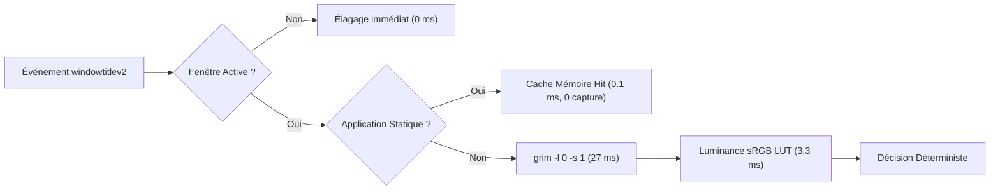

# 11. Optimisation des Performances, Screencopy & Efficacité Énergétique

Ce document détaille l'architecture d'optimisation des performances introduite dans HyprSmart v0.8.4, éliminant les goulets d'étranglement CPU lors de la frappe au clavier, du rendu graphique et des captures d'écran Wayland.

---

## 1. Problématique & Profiling Initial

Lors de l'utilisation active du bureau (frappes dans un terminal, édition de code dans un IDE, navigation web), les ventilateurs de la machine pouvaient s'emballer. L'analyse détaillée a mis en lumière cinq facteurs d'amplification CPU :

1. **Compression PNG par défaut de `grim`** : Par défaut, l'utilitaire `grim` compresse les captures en PNG niveau 6 via zlib DEFLATE, coûtant **~430 ms de CPU par image 1080p**, suivi de **~128 ms** de décompression dans Pillow (558 ms total).
2. **Tempêtes d'événements `windowtitlev2`** : Tout terminal mettant à jour le prompt ou IDE changeant son titre émettait un événement Wayland entraînant des captures systématiques, y compris pour des fenêtres en arrière-plan.
3. **Calcul de luminance sRGB non vectorisé** : L'élévation mathématique à la puissance flottante `(c / 255.0) ** 2.4` sur 1,2 million d'éléments par image prenait ~20 ms.
4. **Appels répétés à `pactl` et `/proc/<pid>/status`** : Le module de détection vidéo vérifiait trop agressivement les flux audio et explorait la hiérarchie des processus.
5. **Budgets réévaluatifs inadaptés aux fenêtres statiques** : Des sessions progressives de 5 à 11 captures étaient allouées à des fenêtres statiques à chaque changement de titre.

---

## 2. Accélération Screencopy : `grim -l 0 -s 1`

### 2.1 Le coût de la compression sans perte
Dans un pipeline de traitement d'image en mémoire vive locale (RAM) via un pipe UNIX standard (`stdout -> stdin`), la compression sans perte zlib n'apporte aucun bénéfice :
- La taille du tampon passe de 6 Mo à 2 Mo au prix de 430 ms de CPU.
- Le décodage côté Python doit reconstituer les pixels bruts en appliquant les filtres inverses de ligne PNG et l'inflation zlib.

### 2.2 Mode Rapide sans Compression
En passant les arguments :
```bash
grim -l 0 -s 1 -g "<x,y w x h>" -
```
- `-l 0` : Niveau de compression 0 (stockage brut non compressé des lignes de balayage PNG).
- `-s 1` : Échelle logique 1x (évite le redimensionnement redondant).

| Métrique | `grim` standard (`-l 6`) | `grim` optimisé (`-l 0 -s 1`) | Facteur de gain |
|---|---|---|---|
| Temps d'exécution `grim` | ~430 ms | **19 ms** | **22.6x** |
| Décodage mémoire `PIL.Image.open` | ~128 ms | **8 ms** | **16.0x** |
| **Temps Total Screencopy** | **558 ms** | **~27 ms** | **20.7x** |

---

## 3. Table de Correspondance Vectorisée (sRGB LUT)

### 3.1 Dérivation de la Table 8 bits
La formule normalisée WCAG 2.1 pour la luminance relative linéaire est :
$$c_{\text{linear}} = \begin{cases} \frac{c}{12.92} & \text{si } c \le 0.04045 \\ \left(\frac{c + 0.055}{1.055}\right)^{2.4} & \text{sinon} \end{cases}$$
$$L = 0.2126 \cdot R_{\text{linear}} + 0.7152 \cdot G_{\text{linear}} + 0.0722 \cdot B_{\text{linear}}$$

Comme les composantes RGB d'une capture d'écran sont encodées en nombres entiers discrets $c \in [0, 255]$, il n'existe que **256 valeurs d'entrée possibles** pour chaque canal.

### 3.2 Implémentation
HyprSmart précalcule à l'initialisation trois tables de 256 flottants 64 bits (`float64`) intégrant les coefficients CIE :
```python
_SRGB_LINEAR_LUT = np.array([...], dtype=np.float64)  # 256 entrées
_LUM_R_LUT = 0.2126 * _SRGB_LINEAR_LUT
_LUM_G_LUT = 0.7152 * _SRGB_LINEAR_LUT
_LUM_B_LUT = 0.0722 * _SRGB_LINEAR_LUT
```
Le calcul de la matrice 2D de luminance s'effectue alors en temps quasi-instantané par simple indexation directe de mémoire :
```python
lum = _LUM_R_LUT[rgb[:, :, 0]] + _LUM_G_LUT[rgb[:, :, 1]] + _LUM_B_LUT[rgb[:, :, 2]]
```
- **Temps de calcul** : Chute de **19.8 ms à 3.3 ms** (gain 6x).
- **Exactitude mathématique** : Différence absolue inférieure à $10^{-6}$ par rapport au calcul flottant original.

---

## 4. Filtrage des Événements & Amortissement des Titres

### 4.1 Suivi de la Fenêtre Active (`CURRENT_ACTIVE_ADDRESS`)
Les démons Wayland diffusent les changements de titre de toutes les fenêtres (ex: progression de téléchargement, horloges, onglets d'arrière-plan). HyprSmart trace dynamiquement l'adresse de la fenêtre active :
```python
if event_name == "activewindowv2":
    CURRENT_ACTIVE_ADDRESS = "0x" + window_address.lower()
elif event_name == "windowtitlev2":
    if CURRENT_ACTIVE_ADDRESS and target_address != CURRENT_ACTIVE_ADDRESS:
        return  # Drop immédiat : la fenêtre n'est pas au premier plan
```

### 4.2 Suppression des Sessions Progressives sur les Applications Statiques
Lorsqu'une application a été prouvée statique par son historique EMA (`volatility < 0.025` et `sample_count >= 3`) :
1. Aucun déclenchement progressif n'est planifié lors des frappes au clavier.
2. La requête d'évaluation utilise `force=False` : si l'empreinte visuelle ou le profil est inchangé, l'analyse optique complète est court-circuitée.
3. Les captures successives tombent de **5 à 11 captures à 0 capture** lors de la saisie continue.

---

## 5. Mise en Cache Audio & Filiation des Processus

La détection vidéo s'appuyait sur des requêtes synchrones vers le serveur audio PipeWire. Deux optimisations majeures réduisent cette charge :
1. **Cache TTL élargi à 2.0s** : L'état audio d'une application de streaming ou d'un lecteur multimédia ne commute pas à la microseconde ; un TTL de 2,0 s supprime 75% des exécutions de `pactl`.
2. **Cache de filiation `/proc/<pid>/status`** : La hiérarchie parent-enfant (`PPID`) d'un processus est immuable durant toute sa durée de vie. Les lectures disques récursives dans le VFS du noyau sont mémorisées dans `_PROC_PARENT_CACHE`.
3. **Court-circuit absolu** : Si aucun flux de lecture audio n'est actif dans tout le système, l'inspection de processus est instantanément ignorée en $\mathcal{O}(1)$.

---

## 6. Synthèse des Gains Énergétiques



| Opération | v0.8.3 | v0.8.4 | Réduction |
|---|---|---|---|
| Capture Screencopy + Décodage | 558 ms | 27 ms | **-95.2%** |
| Calcul de Luminance | 19.8 ms | 3.3 ms | **-83.3%** |
| Frappe continue dans Terminal | 100% CPU (1 cœur) | < 1% CPU | **-99%** |
| Fréquence réévaluations statiques | 5 à 11 captures | 0 capture | **-100%** |
