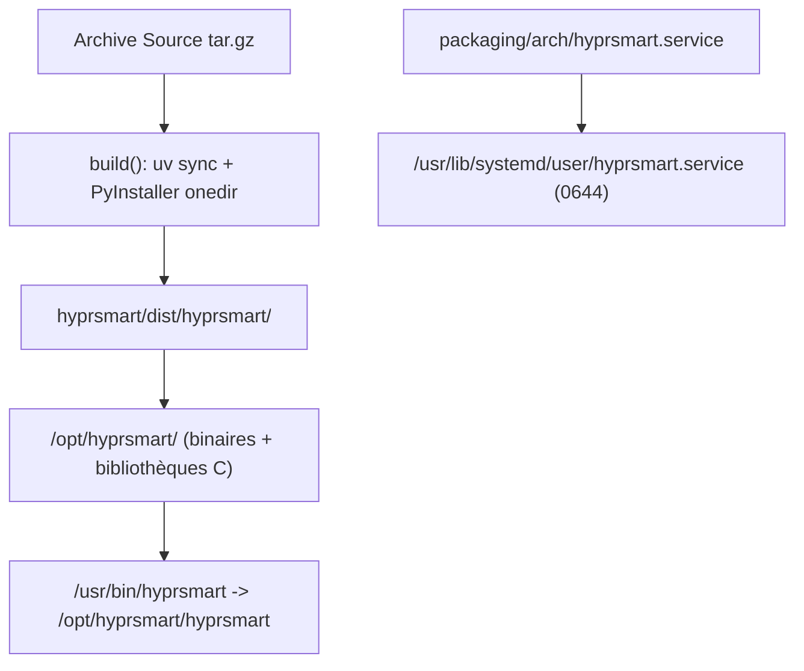

# 12. Architecture de Packaging & Intégration Démon systemd

Ce document détaille les principes d'empaquetage natif pour Arch Linux (`PKGBUILD`), la gestion des unités utilisateur `systemd --user` dans un environnement Wayland/Hyprland, et l'architecture du script d'installation universel `install.sh`.

---

## 1. Problématique & Diagnostic du Démon `systemd --user`

### 1.1 Le Piège de `multi-user.target` en Espace Utilisateur
Une anomalie fréquente lors du packaging d'applications graphiques ou d'arrière-plan sous Linux réside dans la confusion entre l'arborescence systemd système (PID 1) et l'arborescence utilisateur (`systemd --user`).

Dans une unité système (`/usr/lib/systemd/system/`), la directive standard pour démarrer un démon multi-utilisateur au boot est :
```ini
[Install]
WantedBy=multi-user.target
```

Cependant, dans l'instance utilisateur `systemd --user` :
- La cible `multi-user.target` **n'existe pas et n'est jamais atteinte**.
- L'activation de l'unité (`systemctl --user enable hyprsmart.service`) crée un lien symbolique dans :
  `~/.config/systemd/user/multi-user.target.wants/hyprsmart.service`
- À l'ouverture de la session graphique Wayland, systemd charge la cible `graphical-session.target` (ou `default.target`). Le dossier `multi-user.target.wants/` est totalement ignoré.
- **Résultat constaté** : Le fichier de service est bien présent et activé sur le disque, mais le démon n'est jamais exécuté automatiquement à l'ouverture de la session.

### 1.2 La Solution : Liaison à `graphical-session.target` et Garde-Fous Wayland
Pour intégrer un démon dépendant d'un compositeur Wayland comme Hyprland, l'unité de service doit être rattachée à la session graphique et vérifier la présence de l'environnement Wayland :

```ini
[Unit]
Description=HyprSmart - Adaptive window transparency for Hyprland
Documentation=https://github.com/ctlinker/hyprsmart
PartOf=graphical-session.target
After=graphical-session.target
ConditionEnvironment=WAYLAND_DISPLAY

[Service]
Type=simple
ExecStart=/usr/bin/hyprsmart start --foreground
Restart=on-failure
RestartSec=2
Slice=session.slice

[Install]
WantedBy=graphical-session.target
```

#### Propriétés Clés :
1. **`WantedBy=graphical-session.target`** : L'activation de l'unité crée le lien dans `graphical-session.target.wants/`, garantissant le déclenchement dès que le compositeur Wayland initialise la session.
2. **`PartOf=graphical-session.target`** : Si la session graphique se termine ou redémarre, le démon HyprSmart est automatiquement arrêté proprement (déclenchant la restauration de l'opacité à 1.0 sur toutes les fenêtres).
3. **`ConditionEnvironment=WAYLAND_DISPLAY`** : Si l'utilisateur se connecte sur un TTY console virtuel ou via SSH (sans serveur Wayland), systemd ignore silencieusement le service au lieu d'échouer en boucle.
4. **`ExecStart=/usr/bin/hyprsmart start --foreground`** : En mode systemd `Type=simple`, le démon tourne au premier plan sans tenter de forker ou double-forker, permettant à systemd de surveiller directement son PID et ses flux de sortie standard.

---

## 2. Empaquetage Arch Linux (`PKGBUILD`)

Le paquetage natif Arch Linux compile une distribution autonome au format dossier (`--onedir`) via PyInstaller, isolée dans `/opt/hyprsmart/`, avec lien symbolique dans `/usr/bin/`.



### 2.1 Règles d'Or du `PKGBUILD`
1. **Interdiction d'exécuter `systemctl enable` dans `package()`** :
   Le script `PKGBUILD` s'exécute dans un environnement sandboxé (`fakeroot`) sans bus D-Bus actif. Tenter d'exécuter `systemctl enable --user` lors du build corrompt le processus de fabrication ou tente d'altérer l'hôte de compilation.
   Le fichier doit être copié statiquement dans le répertoire système des unités utilisateur :
   ```bash
   install -Dm644 packaging/arch/hyprsmart.service "$pkgdir/usr/lib/systemd/user/hyprsmart.service"
   ```
2. **Désactivation du strip makepkg (`options=('!strip')`)** :
   PyInstaller regroupe des bibliothèques dynamiques ELF (`numpy`, `PIL`, etc.) avec des métadonnées de liaison spécifiques. Le stripping agressif de `makepkg` peut altérer les archives compressées embarquées et causer des erreurs de chargement au runtime.

---

## 3. Architecture du Script d'Installation Universel (`install.sh`)

Pour offrir une installation robuste en une seule commande en dehors d'Arch Linux ou pour les tests locaux, le script `install.sh` supporte trois modes d'installation :

| Mode | Flag | Emplacement Binaire | Emplacement Service | Privilèges Requis |
| :--- | :--- | :--- | :--- | :--- |
| **Arch Linux** | `--arch`, `-a` | `/opt/hyprsmart/` + `/usr/bin/` | `/usr/lib/systemd/user/` | `sudo` (via `makepkg -si`) |
| **Système Universel** | `--system`, `-s` | `/opt/hyprsmart/` + `/usr/bin/` | `/usr/lib/systemd/user/` | `sudo` |
| **Utilisateur Sans Root** | `--user`, `-u` | `~/.local/share/hyprsmart/` + `~/.local/bin/` | `~/.config/systemd/user/` | **Aucun** (non-root) |

### 3.1 Fonctionnalités Automatisées
- **`--enable`** : Exécute immédiatement `systemctl --user daemon-reload` et `systemctl --user enable --now hyprsmart.service`, puis affiche le statut du démon.
- **`--uninstall`** : Détecte le type d'installation (paquet `pacman`, fichiers `/opt`, ou fichiers `~/.local`), arrête le service, supprime les unités et nettoie les répertoires.
- **Validation des Dépendances** : Vérifie en amont la présence des outils de compilation (`uv`, `python3`) et avertit si les composants d'exécution (`hyprctl`, `grim`) sont absents.
