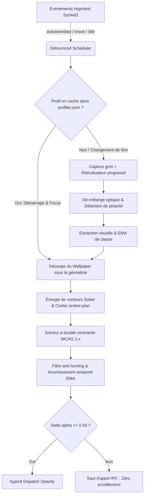

# HyprSmart — Architecture Technique & Guide Développeur

Bienvenue dans la documentation technique et le guide développeur de **HyprSmart** (*Core Engine & Python Package*).

Ce document regroupe les détails d'implémentation bas niveau, le pipeline décisionnel, les fondements mathématiques, les procédures de build et l'outillage de diagnostic.

---

## 1. Vue d'Ensemble de l'Architecture

HyprSmart fonctionne selon un pipeline déterministe temps réel ($< 1.5\text{ ms}$ de calcul par décision), éliminant tout recours à l'OCR ou aux modèles de vision neuronaux lourds.

### Pipeline Décisionnel



---

## 2. Fondements Mathématiques & Algorithmiques

### 2.1 Luminance Relative sRGB & Contraste WCAG 2.1
La luminance relative $L$ d'un pixel sRGB normalisé $c \in [0, 1]$ est calculée via dé-linéarisation gamma vectorisée (accélérée par table de correspondance LUT 256 octets) :

$$c_{lin} = \begin{cases} \frac{c}{12.92} & \text{si } c \le 0.04045 \\ \left(\frac{c + 0.055}{1.055}\right)^{2.4} & \text{sinon} \end{cases}$$

$$L = 0.2126 R_{lin} + 0.7152 G_{lin} + 0.0722 B_{lin}$$

Le ratio de contraste WCAG entre le texte de premier plan $L_t$ et l'arrière-plan composite $L_{bg}(\alpha)$ est défini par :

$$C = \frac{\max(L_t, L_{bg}(\alpha)) + 0.05}{\min(L_t, L_{bg}(\alpha)) + 0.05} \ge C_{cible} \quad (\text{défaut : } 6.0)$$

### 2.2 Dé-mélange Optique (*Optical Unblending*)
Lorsqu'une fenêtre est déjà transparente avec une opacité $\alpha$, la capture d'écran mélange la fenêtre avec le fond d'écran ($L_{capture} = \alpha L_{pure} + (1 - \alpha) L_{backdrop}$). Pour éviter les boucles de rétroaction et flashes, HyprSmart inverse analytiquement le mélange alpha pour reconstruire la couleur réelle :

$$L_{pure} = \frac{L_{capture} - (1 - \alpha) L_{backdrop}}{\alpha}$$

### 2.3 Énergie de Contours Sobel (*Spatial Clutter*)
L'encombrement visuel de la portion de fond d'écran sous la fenêtre est mesuré par convolution avec des filtres de Sobel $3 \times 3$ :

$$G_x = \begin{bmatrix} -1 & 0 & 1 \\ -2 & 0 & 2 \\ -1 & 0 & 1 \end{bmatrix} * I, \quad G_y = \begin{bmatrix} -1 & -2 & -1 \\ 0 & 0 & 0 \\ 1 & 2 & 1 \end{bmatrix} * I$$

$$E = \frac{1}{N} \sum \sqrt{G_x^2 + G_y^2}$$

Si l'arrière-plan présente de fortes fréquences spatiales ($E > 0.15$), la pénalité de contraste contraint l'opacité vers le haut pour garantir la lisibilité des glyphes.

---

## 3. Heuristiques & Sous-Systèmes

### 3.1 Détection Vidéo Multi-Signaux
Pour préserver la fidélité des flux multimédias (lecteurs vidéo, streaming YouTube/Twitch), HyprSmart croise 4 signaux d'activité :
1. **Flux audio PipeWire** : Interrogation des flux de lecture actifs et résolution de la filiation des processus via `/proc/<pid>/status` (avec TTL de cache de 2s).
2. **Inhibition de veille Wayland** : Détection des verrous d'inhibition d'inactivité (*idle-inhibit*).
3. **État plein écran** : Détection de l'état `fullscreen` via l'IPC Hyprland.
4. **Faible densité textuelle** : Ratio texte/fond $< 0.08$.

Lorsqu'une vidéo est confirmée, l'opacité est automatiquement verrouillée à `video_opacity` (défaut : `0.92`).

### 3.2 Profils Dynamiques & Amortissement Anti-Wobble
- **Persistance (`~/.config/hyprsmart/profiles.json`)** : Les empreintes visuelles (`text_l`, `bg_l`, `text_density`) et dynamiques (`volatility`, `settle_time`, `sample_count`) sont apprises par fenêtre et par classe via des moyennes mobiles exponentielles (EMA).
- **Réévaluation progressive** : Les fenêtres lentes à charger (navigateurs, applications Electron) sont sondées sur un cycle cadencé (jusqu'à 11 ticks de 1s, avec arrêt anticipé après 8 secondes stables).
- **Filtre anti-hunting** : Amortissement temporel sur les micro-variations ($\le 0.10$), atténuation du bruit spatial de texture à 50% et recuit du seuil de sensibilité au-delà de 3s.
- **Bascule franche de polarité** : Si un changement radical de luminosité intervient ($|\Delta L| > 0.25$, ex: page blanche après splash screen sombre), le filtre est immédiatement court-circuité pour s'adapter à 100%.

---

## 4. Modèle de Sécurité & Bouclier de Confidentialité

### 4.1 Protection des Applications Sensibles (`blacklist.yaml`)
Les gestionnaires de mots de passe, invites de trousseau d'authentification et fenêtres privées sont automatiquement exclus de toute capture d'écran et maintenus à `1.0` d'opacité :
- Classes protégées par défaut : `keepassxc`, `bitwarden`, `1password`, `polkit`, `pinentry`.
- Mots-clés de titre surveillés : `private browsing`, `incognito`, `authentication required`, `unlock keyring`.
- La liste noire est externalisée dans un fichier protégé en écriture (`0o444`) sous `~/.config/hyprsmart/blacklist.yaml` ou `/etc/hyprsmart/blacklist.yaml`.
- Les modifications via le CLI (`hyprsmart blacklist add/remove/lock`) nécessitent une confirmation interactive avec élévation de privilèges (`pkexec` ou `sudo`) via l'utilitaire système `/usr/bin/install -m 0444 -D`.

### 4.2 Durcissement IPC & Authentification Noyau
- **Authentification `SO_PEERCRED` hermétique (*Fail-Closed*)** : Le socket UNIX `/run/user/<uid>/hyprsmart/control.sock` valide l'UID noyau du client appelant (`st_uid == os.geteuid()`). Tout échec ou incertitude entraîne le rejet immédiat de la connexion.
- **Permissions strictes** : Socket en `0o600`, fichier PID écrit de façon atomique via `.tmp.<pid>` en `0o600`, et répertoire d'état/logs sous `$XDG_STATE_HOME/hyprsmart/` verrouillé en `0o700`.

---

## 5. Guide de Développement & Environnement Local

### 5.1 Prérequis
- Linux avec Wayland et compositeur Hyprland ($\ge 0.40.0$)
- `grim`, `hyprctl`, et PipeWire (`pactl` ou `pw-cli`)
- `python` ($\ge 3.14$) et gestionnaire `uv` ($\ge 0.5.0$)

### 5.2 Installation & Synchronisation Développeur
```bash
# Cloner le dépôt
git clone https://github.com/ctlinker/hyprsmart.git
cd hyprsmart/hyprsmart

# Installer et synchroniser l'environnement virtuel avec uv
uv sync

# Lancer le démon au premier plan avec logs de débogage
uv run hyprsmart start -f
```

### 5.3 Exécution des Tests Unitaires
HyprSmart dispose d'une suite de tests complète (65 tests) couvrant le solveur WCAG, l'unblending, les profils dynamiques, la détection vidéo, la sécurité IPC et le bouclier de confidentialité :

```bash
cd hyprsmart
uv run python -m unittest discover tests
```

### 5.4 Mode Diagnostic Développeur (*Trace Snapshot*)
Pour capturer et auditer les artefacts complets d'une décision d'opacité en direct :

```bash
uv run hyprsmart --yes-am-a-dev-on-this-project-and-i-fully-understand-what-this-flag-does
```

Cette commande capture la fenêtre active et enregistre dans `~/.local/state/hyprsmart/dev_captures/<timestamp>/` :
- `before.png` : Capture brute avant décision
- `after.png` : Rendu après décision
- `metadata.json` : Données du solveur, découpe de l'arrière-plan, coefficients sRGB et traces de décision

### 5.5 Compilation du Binaire Autonome (PyInstaller)
Le paquet Arch Linux et l'installateur universel s'appuient sur la compilation PyInstaller en mode `--onedir` :

```bash
cd hyprsmart
uv run python -m PyInstaller \
    --clean \
    --noconfirm \
    --onedir \
    --name hyprsmart \
    --collect-all numpy \
    --collect-all PIL \
    --collect-all yaml \
    src/hyprsmart/__main__.py
```
Le résultat compilé se situe dans `hyprsmart/dist/hyprsmart/`.

---

## 6. Schéma de Configuration (`config.yaml`)

Emplacement : `~/.config/hyprsmart/config.yaml`

```yaml
monitors:
  '0': /home/user/Pictures/Wallpapers/mountain.png
  eDP-1: /home/user/Pictures/Wallpapers/mountain.png
default_wallpaper: /home/user/Pictures/Wallpapers/default.png
target_contrast: 6.0        # Ratio de contraste WCAG cible (défaut: 6.0)
floor_opacity: 0.5          # Opacité plancher minimale (défaut: 0.50)
video_opacity: 0.92         # Opacité fixe pour fenêtres vidéo (défaut: 0.92)
debounce_interval: 0.1      # Délai de debounce glissant en secondes (défaut: 0.1)
reeval_max_ticks: 11        # Nombre maximal de ticks de réévaluation (défaut: 11)
reeval_stable_ticks: 8      # Ticks stables nécessaires pour convergence (défaut: 8)
reeval_interval: 1.0        # Intervalle entre chaque tick en secondes (défaut: 1.0)
```

---

## 7. Références & Wiki Approfondi

Pour des démonstrations mathématiques et physiques approfondies, consultez la documentation technique dans [`../docs/wiki/`](../docs/wiki/README.md) :
- [01. Luminance Relative sRGB & Contraste WCAG 2.x](../docs/wiki/under-the-hood/01_wcag_relative_luminance.md)
- [02. Gradients Spatiaux & Détection de Contours Sobel](../docs/wiki/under-the-hood/02_spatial_gradient_and_edge_detection.md)
- [06. Détection Multi-Signaux de Vidéo](../docs/wiki/under-the-hood/06_multi_signal_video_detection.md)
- [08. Dé-mélange Optique & Profils de Classe](../docs/wiki/under-the-hood/08_optical_unblending_and_class_profiles.md)
- [09. Réévaluation Progressive & Anti-Wobble](../docs/wiki/under-the-hood/09_progressive_reevaluation_and_dynamic_profiles.md)
- [10. Modèle de Sécurité & Bouclier de Confidentialité](../docs/wiki/under-the-hood/10_security_model_and_privacy_shield.md)
- [12. Architecture de Packaging & Intégration Démon systemd](../docs/wiki/under-the-hood/12_packaging_and_systemd_daemon.md)