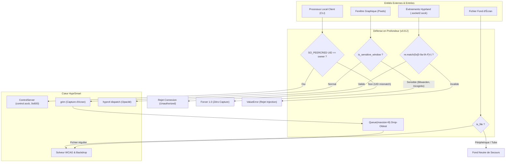

# 10. Modèle de Sécurité, Durcissement IPC & Bouclier de Confidentialité

Ce document détaille le modèle de sécurité de **HyprSmart**, l'analyse de sa surface d'attaque et les mécanismes de défense en profondeur implémentés pour préserver l'intégrité du système et la vie privée de l'utilisateur.

---

## 1. Modèle de Menaces & Surface d'Attaque

En tant que démon résident exécuté dans la session graphique Wayland d'un utilisateur, HyprSmart interagit avec plusieurs interfaces système critiques :
1. **Le compositeur Hyprland** (lecture du socket d'événements `.socket2.sock` et émission d'ordres `hyprctl dispatch`).
2. **Le sous-système de capture d'écran** (`grim`), opérant directement sur la mémoire tampon graphique.
3. **Le serveur audio PipeWire / PulseAudio** (`pactl` et `/proc/<pid>/status`).
4. **Le serveur de contrôle IPC local** (socket UNIX `control.sock`).
5. **Le système de fichiers** (`~/.config/hyprsmart/`, `~/.local/state/hyprsmart/`).



---

## 2. Bouclier de Confidentialité (*Privacy Shield*) & `blacklist.yaml`

### Le Risque : Capture Indiscriminée des Écrans & Altération Non Privilégiée
Par défaut, un démon de gestion adaptative d'opacité capture l'image de la fenêtre active pour en quantifier la couleur et la densité textuelle. Si l'utilisateur consulte un coffre de mots de passe, une fenêtre bancaire ou une invite d'authentification PAM/Polkit, ces données sensibles transitent en mémoire sous forme de tableau de pixels et pourraient, en mode diagnostic, se retrouver écrites sur disque.

De plus, si la liste des applications sensibles résidait dans le fichier utilisateur standard et modifiable `~/.config/hyprsmart/config.yaml`, n'importe quel script malveillant ou processus non privilégié exécuté dans la session utilisateur pourrait silencieusement retirer ces applications de la liste pour déverrouiller la capture d'écran.

### La Solution : Externalisation dans `blacklist.yaml` en Lecture Seule & Escalade de Privilèges
Pour parer à cette menace, la configuration du bouclier de confidentialité est isolée dans un fichier dédié protégé en écriture :
- **Fichier Système** : `/etc/hyprsmart/blacklist.yaml` (priorité maximale si présent, possédé par `root:root`).
- **Fichier Utilisateur** : `~/.config/hyprsmart/blacklist.yaml` (créé en lecture seule avec permissions `0o444`, soit `chmod -w`).

```yaml
# ~/.config/hyprsmart/blacklist.yaml (chmod 0444)
sensitive_classes:
  - 1password
  - bitwarden
  - gcr-prompter
  - keepassxc
  - org.keepassxc.keepassxc
  - pinentry
  - pinentry-gtk-2
  - pinentry-qt
  - polkit-gnome-authentication-agent-1
```

- **Mots-clés de titre protégés par défaut** : `private browsing`, `incognito`, `authentication required`, `unlock keyring`, `pinentry`, `enter password`.

### Mécanisme d'Édition Sécurisée par Escalade de Privilèges (`pkexec` / `sudo` / `doas`) :
Toute modification de la liste noire requiert une confirmation explicite de l'utilisateur avec élévation de privilèges via [`save_blacklist`](../../src/hyprsmart/config.py) :
1. Le fichier temporaire contenant les nouvelles classes est rédigé de manière sécurisée (`0o600`).
2. L'outil d'escalade présent sur le système est détecté (`pkexec` Polkit en priorité pour afficher l'invite graphique, ou `sudo` / `doas`).
3. L'utilitaire standard `/usr/bin/install -m 0444 -D <src> <dest>` est exécuté sous privilèges élevés, garantissant en une seule étape atomique la création de répertoires, la copie, la propriété root/système et les droits `0o444`.
4. Le fichier temporaire est immédiatement purgé du disque.
5. Le démon en cours d'exécution est automatiquement notifié via l'IPC pour recharger sa configuration sans redémarrage.

### Commandes CLI Dédiées :
- `hyprsmart blacklist` ou `hyprsmart blacklist list` : Affiche l'état de la liste noire (chemin, statut lecture seule, propriétaire, outil d'escalade détecté et classes protégées).
- `hyprsmart blacklist add <class_name> [...]` : Ajoute une ou plusieurs classes et déclenche l'escalade de privilèges Polkit/sudo.
- `hyprsmart blacklist remove <class_name> [...]` : Retire une classe de la liste avec validation privilégiée.
- `hyprsmart blacklist lock [--system]` : Réapplique strictement les permissions `0o444` (et promeut en `/etc/hyprsmart/blacklist.yaml` avec `--system`).

### Comportement du Bouclier :
1. **Zéro Capture** : L'appel à `grim` n'est jamais déclenché pour une fenêtre sensible.
2. **Opacité Forcée à 1.0** : La fenêtre reste opaque (`1.0`) pour éviter tout regard indiscret à travers la vitre.
3. **Zéro Persistance** : Le mode diagnostic [`dev_trace`](../../src/hyprsmart/daemon/dev_trace.py) refuse formellement de générer des bundles (`before.png`, `after.png`, `metadata.json`) pour les fenêtres sensibles.
4. **Annulation Progressive** : Toute session de réévaluation progressive en cours est immédiatement révoquée.

---

## 3. Durcissement du Socket UNIX & Authentification `SO_PEERCRED`

### Le Risque : Hijacking et Émission d'Ordres Arbitraires
Dans les environnements multi-utilisateurs Linux, un socket situé dans `/tmp` sans vérification de droits peut être détourné ou manipulé par un autre utilisateur non privilégié de la même machine pour arrêter le démon (`cmd: "stop"`), activer le mode trace ou modifier la configuration.

### La Solution :
1. **Emplacement Isolé** : Le socket est placé dans `$XDG_RUNTIME_DIR/hyprsmart/` (droits `0o700` gérés par systemd/logind). En cas d'absence de la variable, un repli sécurisé `/tmp/hyprsmart-<uid>` avec permissions strictes `0o700` est créé.
2. **Permissions du Socket** : Application immédiate de `0o600` lors du `bind()`.
3. **Contrôle d'Identité Noyau (`SO_PEERCRED`)** :
   À chaque connexion entrante sur le socket, le noyau Linux fournit de manière infalsifiable les identifiants du client appelant :
   ```python
   cred = conn.getsockopt(socket.SOL_SOCKET, socket.SO_PEERCRED, struct.calcsize("3i"))
   pid, peer_uid, gid = struct.unpack("3i", cred)
   if peer_uid != os.getuid():
       # Rejet immédiat de la requête
       conn.close()
   ```

---

## 4. Bornage des Files d'Attente & Protection Anti-DoS (OOM)

### Le Risque : Saturation Mémoire sur Rafale d'Événements
Une application hostile ou mal codée changeant son titre ou créant des fenêtres 100 fois par seconde peut saturer une file d'attente FIFO infinie. Sur un affichage 4K, chaque capture non compressée en mémoire représente 15 à 30 Mo. Une accumulation de 200 captures provoquerait l'arrêt du démon par le noyau (*OOM Killer*).

### La Solution : File Bornée à Éviction du Plus Ancien (*Drop Oldest*)
`CAPTURE_QUEUE` et `LUMINANCE_QUEUE` sont bornées à **8 éléments** (`maxsize=8`).
Lorsqu'un élément est inséré alors que la file est saturée, le worker dépile et abandonne silencieusement la requête la plus ancienne pour ne conserver que l'état le plus récent :
```python
def _enqueue_capture(item: tuple) -> None:
    try:
        CAPTURE_QUEUE.put_nowait(item)
    except Full:
        try:
            _ = CAPTURE_QUEUE.get_nowait()
            CAPTURE_QUEUE.task_done()
        except Empty:
            pass
        try:
            CAPTURE_QUEUE.put_nowait(item)
        except Full:
            pass
```

---

## 5. Validation Stricte des Entrées & Assainissement

1. **Validation Hexadécimale de l'Adresse Hyprland** :
   Dans [`set_hyprland_win_opacity`](../../src/hyprsmart/primitive/window.py), l'adresse est vérifiée par `^0x[0-9a-fA-F]{1,16}$`. Tout caractère spécial (`"`, `;`, `\n`) est rejeté avec une `ValueError` avant tout contact avec le dispatcher.
2. **Validation des Fichiers de Fond d'Écran** :
   Dans [`backdrop.py`](../../src/hyprsmart/opacity/backdrop.py), `os.path.isfile(path)` garantit que le chemin ne correspond ni à un tube nommé (FIFO) ni à un nœud de périphérique (`/dev/zero`, `/dev/urandom`), prévenant tout blocage indéfini des threads de calcul.
3. **Atomicité des Fichiers de Configuration** :
   [`save_config`](../../src/hyprsmart/config.py) écrit d'abord dans `config.yaml.tmp` avec permissions `0o600`, puis effectue un remplacement atomique `os.replace` pour éviter toute corruption de configuration lors d'un arrêt imprévu.
4. **Interdiction d'Exécution Root** :
   Le CLI [`main()`](../../src/hyprsmart/cli.py) vérifie `os.geteuid() == 0` et interrompt immédiatement l'exécution pour prévenir toute compromission de fichiers système.
