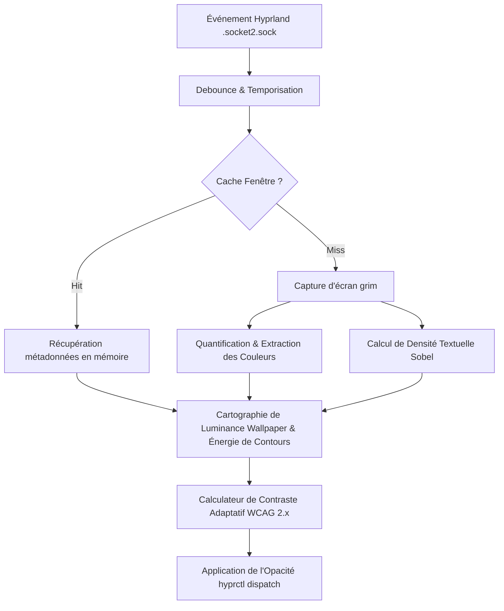

# Under The Hood — Concepts Fondamentaux de HyprSmart

Ce dossier documente les principes mathématiques, physiques, algorithmiques et système qui rendent **HyprSmart** possible.

---

## 1. Vue d'Ensemble & Pipeline de Décision

HyprSmart résout le problème de lisibilité des fenêtres transparentes sous Hyprland sans recourir à des modèles d'IA lourds et lents, grâce à un pipeline déterministe temps réel ultra-léger (< 5 ms de calcul).

---

## 2. Sommaire des Concepts

Chaque document explore en profondeur un pilier technique :

1. [**01. Luminance Relative sRGB & Contraste WCAG 2.x**](01_wcag_relative_luminance.md)
   *Linéarisation sRGB, pondérations chromatiques CIE, formule de contraste WCAG et modélisation optique du mélange alpha.*
2. [**02. Gradients Spatiaux & Détection de Contours (Sobel)**](02_spatial_gradient_and_edge_detection.md)
   *Noyaux de convolution 2D, magnitude du gradient, théorie de l'encombrement visuel (clutter) et assouplissement adaptatif.*
3. [**03. Analyse du Contenu des Fenêtres**](03_window_content_analysis.md)
   *Quantification rapide par décalage de bits, extraction de la couleur de fond dominante, détection de texte et calcul du taux d'espace négatif.*
4. [**04. Échantillonnage du Fond d'Écran & Mise en Cache**](04_wallpaper_sampling_and_caching.md)
   *Sous-échantillonnage Lanczos en mode cover, correspondance des coordonnées moniteur/fenêtre, et stratégies de cache mémoire mtime.*
5. [**05. IPC Wayland, Threading & Architecture Système**](05_wayland_ipc_and_threading.md)
   *Sockets UNIX Hyprland, files de messages producteur-consommateur, serveur de contrôle CLI et restauration d'opacité.*
6. [**06. Détection Multi-Signaux de Vidéo**](06_multi_signal_video_detection.md)
   *Invalidation de veille Wayland, flux audio PipeWire (/proc PPID), heuristiques visuelles de scène et clamp d'opacité dédié.*
7. [**07. Caching Dynamique, Exécution Différée & Préservation des Snapshots**](07_dynamic_caching_and_deferred_execution.md)
   *Ordonnanceur glissant (trailing debounce), cache hiérarchique avec repli dynamique par classe, anti-contamination de transparence et diffing d'opacité.*
8. [**08. Dé-mélange Optique & Profils Génériques de Classe**](08_optical_unblending_and_class_profiles.md)
   *Inversion mathématique de l'alpha compositing, profils de classe EMA et régularisation adaptative sans clignotement.*
9. [**09. Réévaluation Progressive & Profils Dynamiques Émergents**](09_progressive_reevaluation_and_dynamic_profiles.md)
   *Boucle de surveillance annulable (11 ticks, arrêt anticipé à 8 ticks stables), court-circuit d'identité pixel 32x32, bascule de polarité, apprentissage de volatilité (`volatility`, `settle_time`) et amortissement anti-wobble / anti-hunting.*
10. [**10. Modèle de Sécurité, Durcissement IPC & Bouclier de Confidentialité**](10_security_model_and_privacy_shield.md)
   *Authentification SO_PEERCRED, permissions de socket 0o600, protection contre les captures de fenêtres sensibles, bornage anti-DoS des files d'attente et validation des adresses.*

---

## 3. Règle d'Archivage

> [!IMPORTANT]
> **Politique d'évolution documentaire** :
> Si une brique algorithmique ou un concept présent dans ce dossier est déprécié, remplacé ou supprimé du code source, son document explicatif **ne doit pas être effacé**, mais obligatoirement déplacé dans le sous-dossier [`archives/`](archives/) avec une note expliquant la raison de sa dépréciation et la solution qui lui a succédé.

Consultez [archives/](archives/) pour retrouver les concepts historiques (notamment l'approche Vision-LLM v1).
